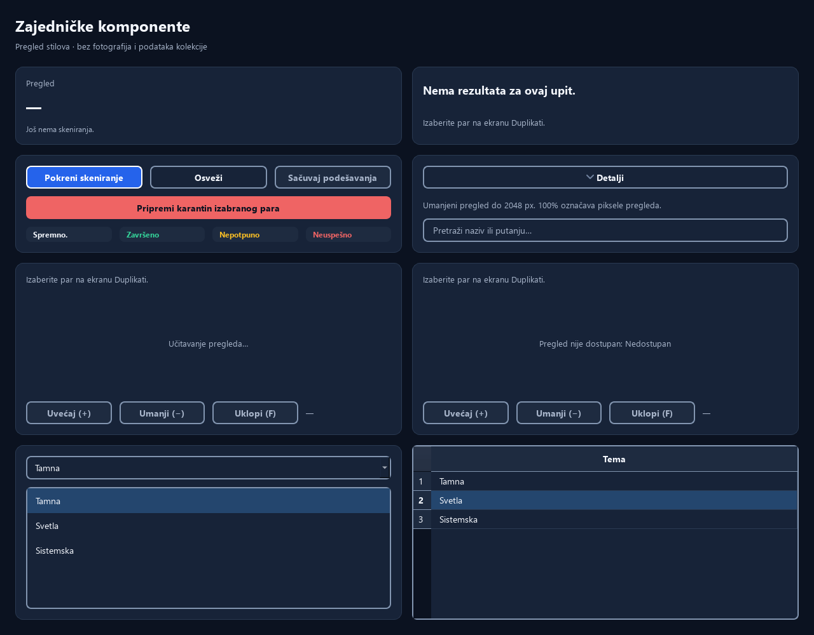
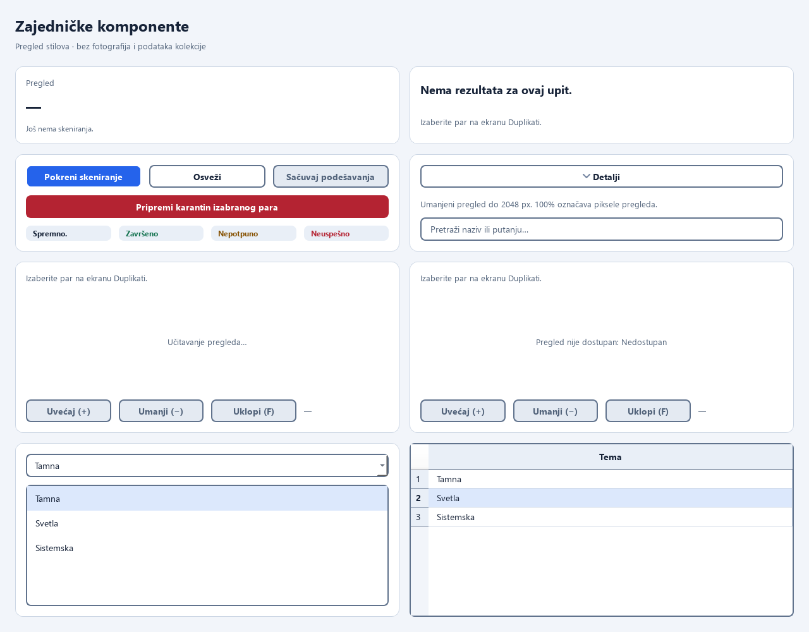

# Qt design system

## Task015 — surfaces, borders and local line icons (2026-11-10)

The existing `themes.py` remains the only theme system. Its four surface levels
are `background` (page), `surface` (inputs, tables, menus and dialogs), `elevated`
(cards) and `selection` (selected rows and choices). `hover` is a transient state,
not another permanent container level. Light cards are white over a pale page;
Dark cards use the existing raised navy. Decorative `border` separators stay
subtle; `control_border` and `focus` retain >=3:1 contrast on relevant surfaces.
Text/secondary text and action foregrounds retain >=4.5:1 contrast.

Spacing stays 4/8/12/16/24/32 logical px; shared card/preview insets use those
tokens. Radii are 8 controls/badges and 12 cards, including painted group cards.
Buttons and inputs reserve a fixed 1 px outline and remain at least 36 px high.
Hover, focus, disabled and checked states change colors without changing padding
or border width. Checkboxes and item focus retain their fixed 2 px outlines.
Selected navigation has a visible contour; its keyboard focus can override that
contour. Qt checked state remains available to accessibility APIs.

`CollapsibleSection` is a frameless section with a named disclosure button,
spacing and typography. Photo details no longer add another card frame; embedded
preview/source containers hide decorative outer outlines while retaining focus.
Unfocused navigation/disclosure buttons have transparent outlines. Main page
layouts, navigation width and safety/confirmation behavior are unchanged.

`icons.py` supplies one original local SVG family: 24-unit viewBox, 1.75-unit
round strokes and 20 logical px optical size. SVGs are embedded in the existing
Qt resource module. A small QIconEngine colors them at paint time, including
disabled, primary/danger, selected and HiDPI rendering. Existing controls recolor
when System changes without rebuilding choices or losing selection. See
[ICONS.md](../../app/ui/qt/resources/ICONS.md) for CC0 provenance and regeneration.

| Role | Current usage |
|---|---|
| Dashboard, Scan, Duplicates, Quarantine, Settings | Five sidebar destinations and relevant existing actions |
| Search, Filter, Sort | Existing search field and filter/sort controls; all combo choices retain icons |
| Theme, Language | Existing preference selectors, using stable item data |
| Open externally | Existing reports/quarantine folder actions only; photograph opening remains Task021 |
| Restore | Existing history/context restore actions |
| Collapse/expand, Folder | Shared sections and source controls |

Icons supplement localized text and accessible names. No new copy, translations,
fonts, dependencies or network access are introduced. The brand and checkbox mark
are preserved. Platform warning symbols in safety messages remain distinct from
action/navigation icons.

New rendering, keyboard, contrast, live EN/SR/System and geometry tests are in
`tests/test_qt_design_system.py`. Task015 evidence and exact executed results are
in [verification/task015-20261110/README.md](verification/task015-20261110/README.md).
These are offscreen Windows/Fusion checks, not physical DPI or screen-reader
certification. The Task005 notes below describe the original baseline.

## Task005 baseline

Stage B implemented 2026-11-09. The local target_reference.png was inspected for navy surfaces, card hierarchy and photo emphasis. Its photos and counts are illustrative. Screen layout/navigation remain Task006–009.

`themes.py` extends the existing ThemeManager with semantic Dark/Light palettes and one application stylesheet. `border` is decorative; `control_border` identifies interactive boundaries. Primary uses #2563EB with white text. The starting #3B82F6 accent serves non-text indicators; links have separate readable colors. Light status text uses darker semantic colors.

Spacing: 4/8/12/16/24/32 logical px. Radii: 8 controls, 12 cards. Buttons/inputs have a 36 px minimum outer height and grow with content. Typography: title 24, section 18, body 14, metadata 13, small 12 logical px. Qt performs device scaling. Fonts: installed Segoe UI, Noto Sans, DejaVu Sans, then platform default. No network fonts or settings format changes.

Dialogs, menus, tooltips, lists, tables, inputs, previews and checkboxes share styles. Tooltips receive an explicit palette on theme changes. Hover/focus preserve border widths and padding. Action focus colors contrast with their fills. Disabled text remains readable.

| Component in components.py | Contract |
|---|---|
| `PageHeader(title_key, subtitle_key=None)` | Keyed title/subtitle; used by Dashboard |
| `Card().content` | Shared frame and padded vertical layout |
| `StatCard(title_key, value='—', detail_key=None)` | Caller supplies real values; absent values remain absent |
| `EmptyState(title_key='empty', detail_key=None)` | Keyed empty explanation |
| `StatusBadge(key, tone='neutral')` | Explicit status/selection text, independent of color |
| `CollapsibleSection(title_key, expanded=False)` | Checked keyboard button, local arrow and expanded/collapsed description; content in `body_layout` |
| `button(key, callback, layout, variant=None)` | Accessible primary/secondary/danger action |
| `PhotoView` | Empty/loading/unavailable/ready photo card and zoom controls |

The button helper defaults scan/save/compare to primary, quarantine preparation to danger, and other actions to secondary. Plan confirmation uses danger while preserving all approval requirements and the safe default Cancel. Text uses stable shared EN/SR keys through strings.py; Task012 updates existing controls during language switching without changing choice or consent state.

PhotoView receives metadata and decoded QImage results with no file access/decoding. `set_photo()` enters loading, `set_image()` shows the image or plain-text failure, and `reset()` clears stale metadata/previews. Zoom controls and shortcuts cannot zoom an unavailable image. Selection/filter invalidation resets both cards; controller generations still discard stale replies. The full photo-first layout remains Task008.

Three original elementary SVGs use Qt resources; see [ICONS.md](../../app/ui/qt/resources/ICONS.md) for provenance/CC0 terms. QtSvg loads before Windows icon engines. resources_rc.py was regenerated with pyside6-rcc.

[manifest.json](verification/task005/manifest.json) records eight inspected captures: components, dialog, menu and tooltip in both themes. The gallery has no photos, collection metrics, home, index or journal. Theme names are real settings choices; the em dash means no measurement.

Tests cover text/links, disabled states, status badges, action fills/hover, focus and control boundaries: text >=4.5:1, relevant indicators >=3:1. Decorative dividers are intentionally subtler. Keyboard checks cover Tab/Space, actual focus painting, stable geometry and collapsible content. This does not establish full accessibility.

See [TESTING.md](../TESTING.md) for commands, results and corrected early failures. Native Linux, physical DPI, screen reader, full screen/keyboard matrix, packaging and physical storage checks remain open. Rollback affects presentation/resources and preview reset calls only; persisted settings, matching, decoding, schema and safety services are unchanged.
