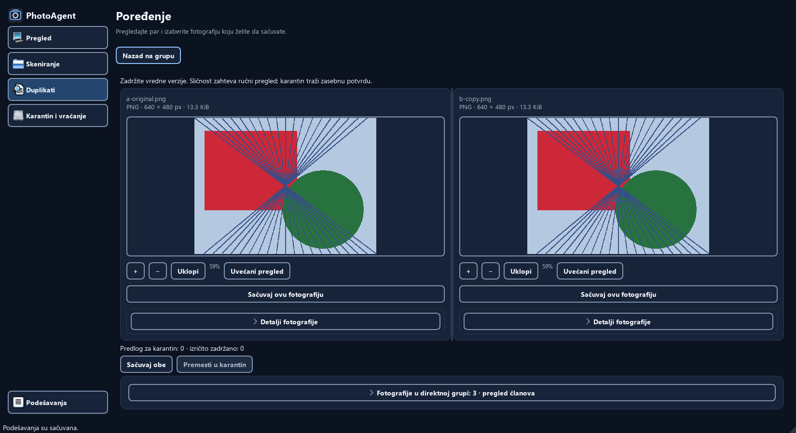
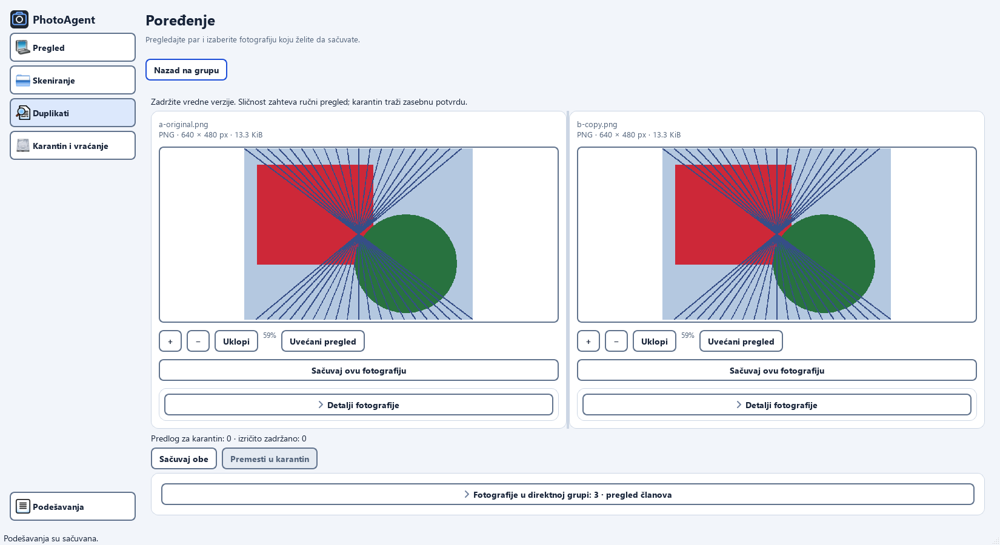

# Task011 — Stage H verification, 2026-11-09

Stage H implements the isolated verification workflow. Full Prompt 6.1 acceptance
remains **open**: native Windows/Linux DPI and assistive-technology checks have not
been performed. This is not the Task013 release audit or packaging validation.

## Scope and isolation

Windows, Python 3.12.10, PySide6/Qt 6.12.0, Fusion, offscreen. Existing project
dependencies were used; no packages were installed. The Microsoft Store interpreter
requires the approved external runner on this host. The initial sandboxed Python
launch failed before running tests and is not counted as verification.

The driver constructs `MainWindow(temporary_home)`. Generated PNG/JPEG photographs,
invalid RAW, home, settings, SQLite index, journal, reports, quarantine and preserved
conflict content all live under a disposable `C:\Windows\Temp\photoagent-task011-*`
directory. Public screenshots therefore contain synthetic paths without the real
account or library location. Child decoders inherit the isolated environment; its
previous values are restored even on exceptions. Workers stop before cleanup.
Output PNGs/manifests remain in the repository; output directories must be new.

Quarantine and restore approvals target only displayed plans for generated files.
Rejected confirmation preserves all original bytes. A real restore conflict keeps
both byte sequences; the generated conflict is moved aside within the sandbox
before approving restore. Restored originals are checked byte-for-byte.
RAW/legacy/XMP warning dialogs and loading/unavailable preview states are explicitly
labeled presentation fixtures, never executed fabricated operation plans.
Cancellation delays extraction and exercises the actual worker cancellation path.

## Flow and evidence

Final evidence: [run directory](verification/prompt-6.1/task011-20261109-r4/),
[100% manifest](verification/prompt-6.1/task011-20261109-r4/100/manifest.json),
[125% manifest](verification/prompt-6.1/task011-20261109-r4/125/manifest.json),
[150% manifest](verification/prompt-6.1/task011-20261109-r4/150/manifest.json).
The [review index](verification/prompt-6.1/task011-20261109-r4/review.json) maps each
contact sheet to its original screenshots and explicitly records visual review.
Manifest hashes verify the original PNGs. Contact sheets are reduced review aids;
they are not used to assert DPI or geometry.

1. Dashboard without a session → Scan without sources → available synthetic source.
2. Running worker → cancellation → complete scan of five generated photographs.
3. Duplicates Grid/List → empty search → direct EXACT group of three → comparison.
4. Keeper choice → Keep Both → loading/unavailable/details → rejected confirmation.
5. Explicit synthetic quarantine → fresh window/services → restore collision →
   explicit restore, with all original bytes recovered.
6. Direct VISUAL review → malformed RAW/offline-source incomplete scan → refused bulk.
7. All Settings sections → saved custom 13/17 matching preference and Light theme →
   fresh window → System Light/Dark/Unknown fallback presentation.

| Surface | Captured states (both themes at 100%, except where noted) |
|---|---|
| Dashboard | No session, actual populated measurements, actual incomplete warning |
| Scan | No source, source, running, cancelled, complete, incomplete/errors/details |
| Duplicates | No session, Grid, List, filtered empty, EXACT three members, VISUAL pair |
| Comparison | Both decoded photos, keeper, Keep Both, loading, unavailable, details |
| Confirmation | Normal, rejected, RAW/legacy/VISUAL/XMP warnings, refused bulk |
| Quarantine | Empty, completed move, restart, real occupied destination, restore confirmation, restored |
| Settings | Top/appearance/language/sources, custom matching, storage/about, persisted Light/custom |
| System | Injected Light → Dark → Unknown/dark fallback at 100%; native OS events unverified |

Every main page and loaded comparison is captured in Dark and Light at all twelve
size/DPR combinations (144 matrix PNGs). The broad matrix uses populated scan and
duplicate results, empty quarantine, and the Settings initial preferences. The
extended state/operation variants above run at 1650×900 / 100%; those variants
are **not** exhaustively repeated at 125/150% or every resolution. Settings is
captured at multiple scroll positions so sections below the fold are represented.
The incomplete dashboard satisfies the stale/incomplete warning case; a separate
stale-only dashboard screenshot is not claimed. Stale-cache/plan/preview behavior
is covered by executable regressions.

| Target physical pixels | Logical 100% | Logical 125% | Logical 150% |
|---|---|---|---|
| 1280×720 | 1280×720 | 1024×576 | 853×480 |
| 1366×768 | 1366×768 | 1093×614 | 911×512 |
| 1650×900 | 1650×900 | 1320×720 | 1100×600 |
| 1920×1080 | 1920×1080 | 1536×864 | 1280×720 |

Qt reports actual DPR 1, 1.25 or 1.5 in separate processes. Integer logical rounding
can change captured physical width/height by one pixel; each manifest records the
actual size. Main-window size must match the requested logical dimensions, page
horizontal scroll maximum must be zero, and visible shell actions must stay inside
the window without overlap. Internal metadata/history tables may scroll. Vertical
scrolling preserves full-sized controls on constrained screens.

## Render review and reference comparison

The source [target_reference.png](target_reference.png) and actual loaded comparison
were opened together. The reference is a conceptual direction; illustrative photos,
numbers, RAW/JPEG classification and English text are not product requirements.

The reviewed application retains the compact 208-logical-pixel navigation, navy/slate
surfaces, blue main actions, consistent cards and shared spacing. Loaded comparison
shows actual generated photographs, short metadata and explicit retention choices;
SHA/paths and uncertainty remain in details. Dark and Light share hierarchy and
alignment. Empty, error and protected-operation states remain readable and distinct.
The actual interface has stronger control outlines and platform-style icons than the
reference; this is an acknowledged visual difference, not pixel-level fidelity.





At 1280×720 / 150%, comparison stacks vertically and requires scrolling to the second
photo/actions. Dashboard statistics also wrap and push candidates below the fold.
This is an explicit density tradeoff; no assertion is made that both photographs or
every action fit simultaneously on these constrained screens. There are no empty
loaded photo scenes in the accepted matrix and no primary-page horizontal overflow.
Loading/unavailable states show explanatory text with disabled preview actions.

No application UI defect was changed in this verification stage. Earlier stages
redesigned Dashboard, Scan, Duplicates/integrated comparison, Quarantine and Settings;
Stage H verifies those existing screens. Shared components under review include
Sidebar, PageHeader, ContextToolbar, Card/StatCard, GroupView, PhotoView,
CollapsibleSection/TechnicalDetails, PlanDialog and ThemeSelector/ThemeManager.
One correction discovered during capture was in the new driver's waiting:
the initial preview-ready signal could precede a queued group-query replacement.
The driver now waits for query completion before requiring both loaded scenes.

The initial incomplete run remains under
`verification/prompt-6.1/task011-20261109/` with `finished: false`; its partial images
are excluded from acceptance. The second run (`task011-20261109-r2/`) completed
both high-DPI matrices and the 100% move/restart/conflict/restore journey, then its
new byte-check helper tried reading the quarantine directory as a file. That driver
error was corrected by checking only the known original fixture paths; its unfinished
100% manifest is also excluded. Failed attempts were not overwritten or relabeled
as passing. A third run (`task011-20261109-r3/`) recorded all states but stopped
making progress during shutdown; only its identified capture process was terminated,
and its synthetic sandbox was removed separately. Its manifest stays unfinished.
An early review invocation correctly rejected this unfinished manifest. The driver
now disposes stopped windows before opening replacements, publishes completion
only after sandbox cleanup, and adds a traceback watchdog around final Qt cleanup.
No application-level shutdown fix or definitive root cause is claimed. Final matrix
validation rejects unfinished manifests.

## Tests, execution and remaining gates

Exact commands, counts and skips are recorded in [TESTING.md](../TESTING.md).
New `tests/test_task011.py` checks all four geometries in both themes with real
decoded previews, expanded details and custom Settings. It also deliberately creates
overflow to prove that the probe detects it, verifies actual DPR, and tests restoring
the capture environment after a failure. Existing regression modules cover EXACT/
VISUAL, three-plus groups, multiple retained keepers, literal global search/numeric
sort, stale preview/plan, rejected consent, RAW/XMP/backup protection, current
source/keeper hashes, missing/changed files, recovery, restart restore and conflicts,
scan cancellation, worker ownership/heartbeat and theme/settings persistence.

Native Windows display/monitor transitions, Linux execution, NVDA/Narrator,
physical separate/removable drives, physical power failure and valid RAW decoding
remain unverified. The native race/process and Tk modules were not rerun: no service,
safety or adapter contracts were changed and no corresponding regression was found.
This is a focused suite, not the complete repository test suite.

Previews remain bounded rendered images (up to 2048 pixels), not proof of RAW quality
or full-resolution identity. Only EXACT is eligible for optional approved bulk;
VISUAL remains manual direct-pair review. DERIVATIVE/SIMILAR_CAPTURE classification,
full EN/SR runtime switching and release packaging remain future tasks. All tested
application operations use local code/services; no cloud/telemetry/API is added.

Normal launch, using the owner's saved state (not used for capture):

```powershell
.\.venv\Scripts\python.exe -B photo_agent.py --ui qt
```

There is no CLI `--home`. Use the capture driver commands in TESTING.md for isolated
verification. `docs/SECURITY.md` is unchanged because the user flow and all safety
guarantees are unchanged.

Changed source files: `tools/capture_task011.py`, `tools/review_task011.py`,
`tests/test_task011.py`. Documentation: `README.md`, `docs/ARCHITECTURE.md`,
`docs/TESTING.md`, `docs/CHANGELOG.md`, `docs/ROADMAP.md`, this report and
the local ignored `task/Task011.md`, plus the new evidence directories. Narrow
`.gitignore` exceptions expose the new report/evidence for review. No application
code changes.
