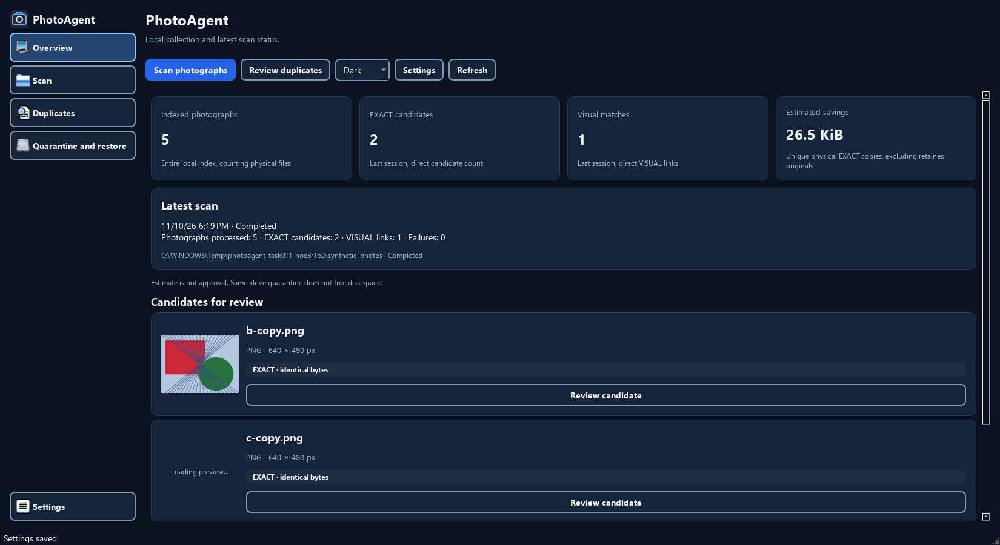
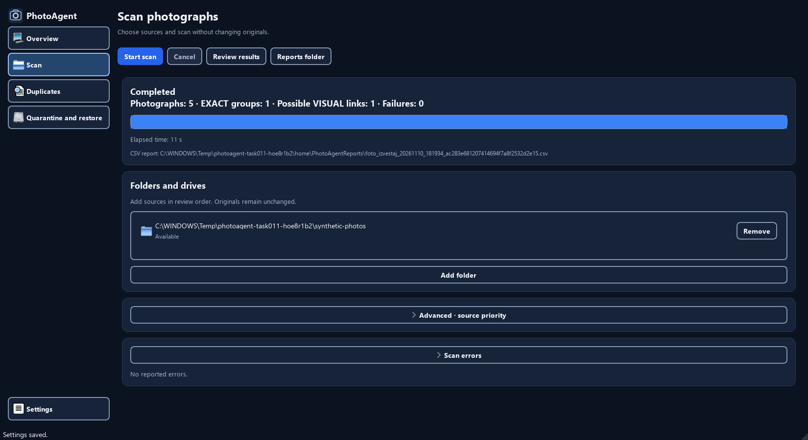
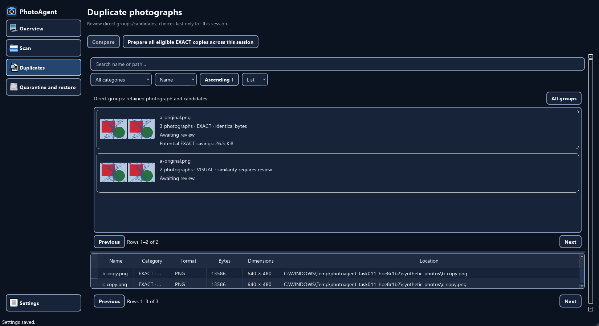
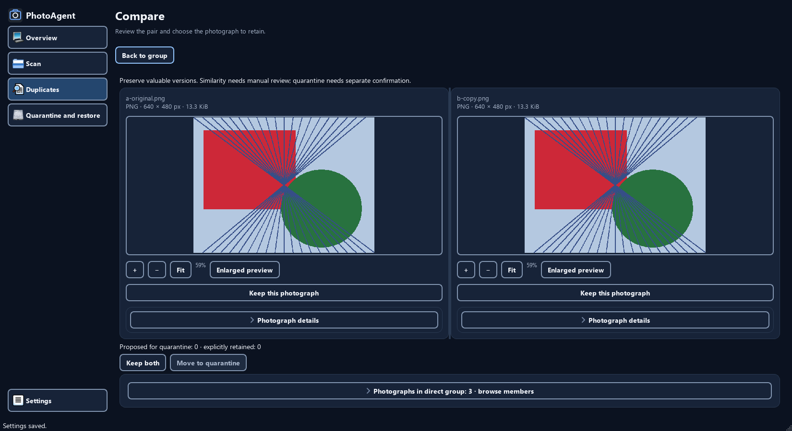
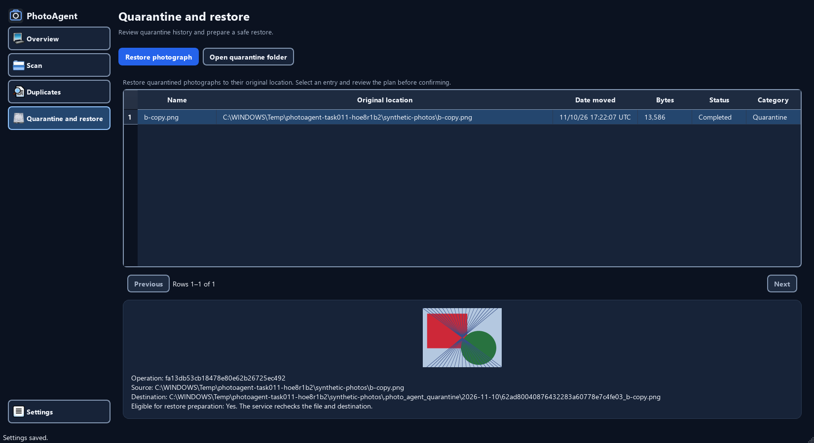
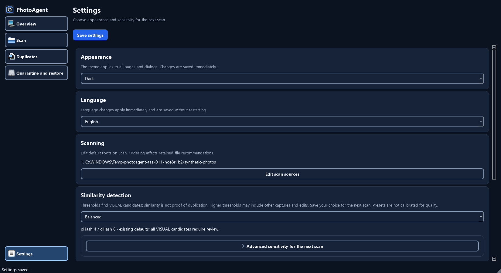

# Task014 — audit i specifikacija UI refinement-a

Datum: 2026-11-10 (Europe/Belgrade). Obim: isključivo Task014, Stage 1.
Status: završeno — audit i specifikacija; implementacija narednih etapa nije započeta.
Ovaj dokument specifikuje buduće izmene; ne tvrdi da su Task015–Task023 implementirani.
Proizvodni kod, matcher, SQLite šema, dekoder, prevodi i safety protokol nisu menjani.

## Osnova i metod

Polazni Git HEAD: `95d5698eccd9335d115c77728b8f76feb1411cf5`; početni
`git status --short` bio je prazan. Napomena iz `task/UI_REFINEMENT.md` o ranijim
nekomitovanim izmenama ne opisuje stanje ovog audita. Ranija zabrana izvršavanja
u dokumentu pripreme ne pokreće ostale zadatke: vlasnik je sada izričito zatražio Task014.

Pregledano:

- `AGENTS.md`, `task/UI_REFINEMENT.md`, `task/Task014.md` i Task015–Task023.
- `docs/ARCHITECTURE.md`, `docs/design/DESIGN_SYSTEM.md`,
  `docs/design/ACCESSIBILITY.md`, `docs/LOCALIZATION.md`, `docs/SECURITY.md`,
  `docs/design/TASK011_VERIFICATION.md`, `docs/design/TASK012_VERIFICATION.md`.
- Qt `navigation.py`, `themes.py`, `components.py`, `dashboard_scan.py`,
  `gallery.py`, `screens.py`, `models.py`, `quarantine_settings.py`, `window.py`,
  `controller.py`; servisni ugovori u `app/core/queries.py`, upiti u
  `app/services/queries.py`, relevantni `application.py`, `quarantine.py`,
  `app/matching/matcher.py`, `indexed.py`, `quality.py`.
- Postojeći sintetički capture alati `capture_ux_audit.py`, `capture_task011.py`,
  `capture_task012.py`; testovi Task008/009/010/011/012 i design-system testovi.
  Rezultati izvršavanja navedeni su zasebno u evidenciji; čitanje testa nije prolaz testa.

### Reference i njihovo poreklo

Sve tri slike su otvorene i vizuelno pregledane. Nijedna tražena referenca ne nedostaje.

| Referenca | Značenje za ovaj plan |
|---|---|
| `docs/design/target_reference.png` | Konceptualna tamna paleta, fotografije u prvom planu, diskretne kartice i linijske ikone. Brojevi, pejzaži i RAW/JPEG oznake su ilustracije, ne dokaz mogućnosti aplikacije. |
| `docs/design/current_ui.png` | Stari priloženi prikaz: šest navigacionih redova, veliki tehnički tekst, prazni pregledi. Nije aktuelni baseline i njegove privatne putanje nisu ponovo kopirane u nove dokaze. |
| `docs/design/reference_sidebar_icons.png` | Priloženi primer kompaktne navigacije samo ikonama. Koristi se za težinu linije, gustinu i raspored; ne preuzimaju se tuđe fotografije, funkcije ni ikonice bez odgovarajuće licence. |

Ranije verifikacije su istorijski kontekst. Novi dokazi su isključivo u
[task014-20261110](verification/task014-20261110/), odvojeno od svih starih artefakata.
[Manifest i zapis provera](verification/task014-20261110/audit.json) povezuju
originalne PNG-ove, SHA-256, stanje, dimenzije, ograničenja i vizuelni pregled.

Snimanje koristi postojeći `MainWindow(temporary_home)`, stvarne Qt widgete,
event loop, workere i servise, Fusion/offscreen na Windows-u, DPR 1.
Application home, izabrani izvori, settings, SQLite, journal, CSV i karantin
su privremeni; Qt INI podešavanja oba scope-a su preusmerena. Sve fotografije
su generisane. Drajver eksplicitno odobrava samo prikazani plan sintetičkog fajla.
Potvrđeni su odbijanje plana, restart, konflikt i vraćanje istih bajtova.
Ovo nije manuelni prolaz fizičkim mišem, native DPI sertifikacija ili test stvarne biblioteke.

## Novi dokazi po iskustvu

Putanje u tabeli su relativne prema `verification/task014-20261110/`.
`baseline/` snima obe teme pri DPR 1; osnovnih šest prikaza obuhvata 1280×720,
1366×768, 1650×900 i 1920×1080. Proširena stanja su na 1650×900.
`supplement-r2/` dopunjava audit na 1280×720, uključujući reprezentativan srpski prikaz.

Prihvaćeno je **130 novih PNG snimaka**: 116 baseline + 14 dopunskih.
Svi su otvoreni kroz 17 završnih preglednih listova, uz zasebno otvaranje
reprezentativnih originala. SHA-256, dimenzije, DPR, page horizontal scroll i
toolbar containment provere su prošle. Prvi `supplement/` pokušaj (12 PNG) i
`audit-initial.json` ostaju sačuvani, ali su zamenjeni: pregled je pokazao da
pojedini otvoreni detalji nisu ušli u viewport. Capture-only čekanje relayout-a
i scroll ispravljeni su u drajveru; aplikacija nije menjana. Stari review listovi
su zadržani. Završni `review-final-01`–`14` su bajt-identični već pregledanim
listovima, dok `15`–`17` uključuju nove dopunske snimke i posebno su otvoreni.

| Iskustvo | Prazno / početno | Popunjeno | Detalji, greške i potvrde |
|---|---|---|---|
| Dashboard | `baseline/dark-dashboard-empty.png` | `baseline/matrix-1650-dark-dashboard.png`; `supplement-r2/04-dashboard-candidates.png` | `baseline/dark-dashboard-incomplete.png`; pravi završen scan bez podudaranja u `supplement-r2/12-dashboard-no-matches.png` |
| Scan | `baseline/dark-scan-empty.png` | `baseline/dark-scan-sources.png`, `dark-scan-running.png`, `dark-scan-complete.png` | `dark-scan-cancelled.png`, `dark-scan-errors.png`, `dark-scan-error-details.png`; `supplement-r2/02-add-folder.png`, `03-scan-advanced.png` |
| Duplicates | `baseline/dark-duplicates-empty.png`, `dark-duplicates-filtered.png` | `baseline/matrix-1650-dark-duplicates.png`, `dark-duplicates-list.png`, `dark-exact-three-members.png` | `supplement-r2/11-duplicates-no-matches.png`; 3+ direktni članovi u `supplement-r2/05-exact-members-expanded.png` |
| Compare/Review | `supplement-r2/01-compare-no-selection.png` | `baseline/matrix-1650-dark-compare.png`, `dark-compare-keeper.png`, `dark-compare-keep-both.png`, `dark-visual-review.png` | `supplement-r2/06-internal-enlarged-preview.png`, `07-actual-photo-details.png`, `08-sr-review.png`; `baseline/dark-confirmation.png`, `dark-confirmation-rejected.png`, `dark-confirmation-warnings.png` |
| Quarantine | `baseline/dark-history-empty.png` | `baseline/dark-history-populated.png`, `dark-history-after-restart.png`, `dark-history-restored.png` | `baseline/dark-restore-conflict.png`, `dark-restore-confirmation.png`, `dark-operation-refused.png` |
| Settings | `baseline/matrix-1650-dark-settings.png` (stvarne početne preference; nema smislenog „praznog” Settings ekrana) | `baseline/dark-settings-custom.png`, `light-settings-persisted.png` | `baseline/dark-settings-matching.png`, `dark-settings-storage-about.png`, `system-light.png`, `system-dark.png`, `system-fallback.png`; `supplement-r2/09-sr-settings-advanced.png`, `10-settings-diagnostic.png` |

Otvoreni Scan error sadržaj, u celosti unutar viewport-a, nalazi se u
[13-scan-actual-error-details.png](verification/task014-20261110/supplement-r2/13-scan-actual-error-details.png).
SR Settings snimak 09 prikazuje donji deo podešavanja sa delom proširenih
pragova; oba kompletna numerička praga vidljiva su u baseline Storage/About snimku.

### Reprezentativni snimci i ocena koraka

1. **Dashboard — razumljiv pregled, potrebno jasnije usmeravanje posle scan-a (D01–D03).**



2. **Scan — prikazuje ishod i izvore, akcije i tehnički sadržaj traže jednostavniju hijerarhiju (S01–S03).**



3. **Duplicates — direktne grupe su dostupne, tabela i dva pager-a povećavaju gustinu (U01–U04).**



4. **Compare/Review — fotografije i zaseban izbor rade u replay-u, konture i pristup članovima traže doradu (C01–C05).**



5. **Quarantine — sintetički restart/konflikt/restore prolaze, oporavak treba manje tehnički predstaviti (Q01–Q03).**



6. **Settings — postojeće preference se čuvaju, razlika između trenutnog čuvanja i Save zahteva pojašnjenje (T01–T02).**



Loading/unavailable preview i kombinovani RAW/legacy/XMP/VISUAL dijalog u
postojećem capture drajveru su **presentation fixtures**, jasno označeni u
manifestu; taj izmenjeni plan se nikad ne izvršava. Settings dijagnostika u
dopuni je ubrizgana prezentacija, ne dokaz neuspelog zapisivanja. Nasuprot tome,
neuspešno dekodiranje sintetičkog `bad.nef`, nedostupan izvor, odbijen bulk i
restore konflikt nastaju stvarnim servisnim pozivima. Matrix Dashboard može
zateći drugu vidljivu sličicu dok se učitava; to nije dokaz pokvarenog dekodera.

## Nalazi, cilj i vlasnik buduće izmene

Prioritet je uticaj na korisnika: P0 = identitet/odobrenje; P1 = tok i razumevanje;
P2 = gustina i vizuelna doslednost. P0 ovde označava šta treba zaštititi/proveriti,
ne novu potvrđenu grešku koja gubi podatke.

| ID / prioritet | Novi dokaz i konkretan nalaz | Ograničena ciljna promena | Zadatak |
|---|---|---|---|
| G01 / P2 | `baseline/dark-dashboard-empty.png`: navigacija ima pune konture oko svih redova; šarene platformske ikone računara, diska i dokumenta odstupaju od referenci. | Jedna lokalna linijska porodica; razdvojiti dekorativnu ivicu od granice kontrole i fokusa. Zadržati vidljiv fokus, tekst i stabilnu geometriju. | Task015 |
| G02 / P1 | Isti snimak i `baseline/matrix-1280-dark-compare.png`: fiksna bočna traka troši 208 logičkih px i ne može da se sklopi. | Početno sklopljena traka, tastaturom dostupan toggle; lokalizovani tooltip-i i nazivi svih pet destinacija, Settings pri dnu. Bez rekonstrukcije ekrana. | Task016 |
| D01 / P1 | `baseline/matrix-1650-dark-dashboard.png`: i posle uspešnog scan-a plava glavna akcija ostaje Scan; Review je sekundaran među Theme/Settings/Refresh. | Jedna dominantna akcija prema stanju: početno Scan Photos, posle rezultata Review Duplicates. Temu i ostale pomoćne akcije vizuelno podrediti. | Task017, Task022 |
| D02 / P1 | Isti snimak: broj 2 znači EXACT kandidata, dok Scan pokazuje jednu EXACT grupu; to je tačno, ali lako se pogrešno poredi. | Dosledno označiti fotografije / direktne veze / grupe. Sažetak poslednjeg scan-a pre dugih putanja; potencijalni bajtovi samo za EXACT i uz postojeću napomenu da karantin ne oslobađa disk. | Task017, Task022 |
| D03 / P2 | `supplement-r2/04-dashboard-candidates.png`: tri kandidata imaju odvojena duga dugmad, sličica je samo 128×96; cela grupa nije prikazana. | Kompaktniji red sa jasnim filename-om, vrstom veze i Review; sličica ostaje konkretni kandidat, nikad simbol cele grupe. | Task017, Task021 |
| S01 / P1 | `baseline/dark-scan-complete.png`: Start scan ostaje plav i posle završetka; Review results nije dominantan. Reports folder i puna CSV putanja konkurišu sledećem koraku. | Po stanju istaknuti Add Folder → Start Scan → Cancel → Review Duplicates. CSV putanju i source priority držati na zahtev; važan ishod i greške ostaju vidljivi. | Task017 |
| S02 / P2 | `baseline/dark-scan-sources.png`, `supplement-r2/03-scan-advanced.png`: kartica, lista izvora, Remove/Add i collapsible kontrole imaju više slojeva okvira. | Manje ugnježdenih ivica, kompaktan spisak sa dostupnošću i jasnim uklanjanjem samo iz liste; zadržati prioritet izvora i puno ime u tooltip-u. | Task015, Task017 |
| S03 / P1 | `baseline/dark-scan-errors.png`, `dark-scan-error-details.png`: incomplete rezultat i offline/bad RAW detalji postoje, ali dugačak tehnički sadržaj otežava sledeći korak. | Vidljiv broj problema i kratka akcija View Scan Errors; dijagnostika na zahtev. Incomplete ostaje samo za pregled, bez quarantine izvršavanja; Cancel i nepoznat napredak bez izmišljenog procenta. | Task017, Task022 |
| U01 / P1 | `baseline/dark-duplicates-list.png`: galerija i tehnička tabela su istovremeno dominantne, sa dva para Previous/Next i All groups dugmetom. | Jedna jasna oblast grupa i Review akcija; parove/paginaciju članova otkriti u kontekstu grupe. Sačuvati paged queries, numerički sort i stabilne ID-eve. | Task018, Task020 |
| U02 / P1 | `baseline/dark-exact-three-members.png`: kartica kaže 3 fotografije, a crta samo dve sličice; dugme Compare polazi od para, ne cele grupe. | Vidljiv broj i npr. „+1 član”, jednoznačan Review group; pojedinačna fotografija ima svoj cilj. Ne predstavljati dve sličice kao kompletnu grupu. | Task018, Task020, Task021 |
| U03 / P1 | `baseline/dark-duplicates-filtered.png`: prazna pretraga je samo poruka pri dnu velike praznine; bulk dugme i dalje zauzima veliko mesto i odnosi se na celu sesiju. | Poruku i reset filtera postaviti blizu pretrage. Jasno odvojiti sekundarni EXACT bulk za celu sesiju od prikazanog filtera; ne preimenovati ga kao da izvršava samo vidljive stavke. | Task018, Task022 |
| U04 / P0 | `baseline/dark-visual-review.png` + pregled `queries.py`/`gallery.py`: Needs Review je prolazni UI status; RAW+JPEG nije posebna klasifikacija. | Koristiti semantiku iz tabele podrške ispod; nema lažnog trajnog review filtera ili tvrdnje o RAW originalu JPEG-a. | Task018, Task022 |
| C01 / P2 | `baseline/matrix-1650-dark-compare.png`, `supplement-r2/07-actual-photo-details.png`: fotografije su već učitane i podaci sklopljeni, ali Card → graphics frame → dugmad → Details card daju više kontura. | Zadržati postojeće photo-first kartice, osnovne podatke i fit/zoom; ukloniti dekorativne slojeve. Details otkrivaju putanju/SHA/heuristiku. | Task015, Task020 |
| C02 / P1 | `baseline/dark-compare-keeper.png`, `dark-compare-keep-both.png`: izbor je eksplicitan i ne pomera fajl; grupa od tri skriva ostale članove ispod akcija. | Jasno razdvojiti preporuku, izabrano za zadržavanje i predlog premeštanja. Jedan donji red sa brojem konkretnih predloga i Move to Quarantine koji otvara postojeći plan. | Task020, Task022 |
| C03 / P1 | `supplement-r2/05-exact-members-expanded.png`: članovi su tabela direktnih parova, ne sve slike kao ravnopravne kartice. | Vidljiv ulaz u člana 2 od 3, lokalni napredak i pregled direktne veze. Neodabrani članovi ostaju netaknuti; više keeper-a je dozvoljeno. | Task020 |
| C04 / P0 | `supplement-r2/06-internal-enlarged-preview.png` i proba dvoklika: interno uvećanje postoji na dugmetu; photo dvoklik trenutno ne pokreće OS viewer. | Razdvojiti spoljašnje otvaranje konkretne fotografije, interni enlarged preview, Review grupu i Keep. Dodati tastaturnu Open in Default Viewer akciju preko servisne provere i malog Qt adaptera. | Task021 |
| C05 / P0 | `baseline/dark-confirmation.png`, `dark-confirmation-warnings.png`: plan navodi source/destination/retain; obavezna upozorenja i RAW/legacy consent su izvan Details. | Skratiti pomoćni tekst i ujednačiti nazive; sačuvati sve stavke, vidljiva upozorenja, Cancel fokus, zabranu Enter odobrenja i novu proveru pred move. | Task020, Task022 |
| Q01 / P1 | `baseline/dark-history-after-restart.png`: istorija ima šest kolona, dodatnu karticu sa operation ID-em i punim putanjama; dominantnost detalja otežava Restore. | Prvo fotografija/stavka, originalna lokacija, status i Restore Photo. ID, destination i dijagnostika u dostupnim Details. Oporavak, offline i konflikt nikad sakriti kao kozmetički detalj. | Task019 |
| Q02 / P0 | `baseline/dark-history-restored.png`, `dark-restore-conflict.png`: vraćena stavka nije aktivan fajl na staroj quarantine putanji; preview je vezan za manifest. | Spoljno otvaranje rešavati preko operation ID-a i aktuelnog autoritativnog stanja. Existing Open quarantine folder ostaje jasno druga akcija. Ni stara source putanja ni redni broj reda nisu identitet. | Task019, Task021 |
| Q03 / P1 | `baseline/dark-history-empty.png`, `dark-restore-confirmation.png`: prazno stanje objašnjava oporavak, a Restore već ima zaseban plan. | Sačuvati ovaj obrazac; jasniji rezultat posle restore-a i smislen fokus nazad na stavku. Neuspešna sličica ne blokira Restore. | Task019, Task022 |
| T01 / P1 | `baseline/matrix-1650-dark-settings.png`: Theme/Language kažu da se čuvaju odmah, a glavno dugme kaže Save settings; pragovi zahtevaju Save za sledeći scan. | Objasniti razliku: izgled/jezik odmah, Save za matching preference sledećeg scan-a. Ne menjati postojeće čuvanje ili dodavati settings. | Task019, Task022 |
| T02 / P2 | `baseline/dark-settings-storage-about.png`, `supplement-r2/09-sr-settings-advanced.png`: duga vertikalna lista kartica, bez jasnog primata osnovnih opcija. | Kompaktne grupe Appearance, Language, Scanning, Safety, Storage; pHash/dHash i putanja baze na zahtev; Safety ostaje zaključan. Očuvati Custom 13/17 i restart. | Task019 |
| A01 / P1 | `supplement-r2/08-sr-review.png` i mali matrix prikazi: dugački prevodi i veliki okviri troše prostor. Snimak sam ne dokazuje screen-reader ponašanje. | U svakoj etapi proveriti EN/SR, Tab/Shift+Tab, Enter/Space/Escape, tekstualni selected status, bez pomeranja na hover/focus. Tekst ≥4.5:1, relevantne kontrole/fokus ≥3:1; native čitači zasebno. | Task015–Task023 |

Potvrđene prednosti koje treba sačuvati: pet jasnih destinacija; Compare unutar
Duplicates; učitane stvarne fotografije u obe teme; sklopljeni metapodaci;
tekstualna upozorenja koja ne zavise samo od boje; konkretan frozen plan;
bez prepisivanja pri restore konfliktu. Nalazi ne zahtevaju novi UI framework.

## Tok i progresivno otkrivanje

1. **Add folders**: Scan bez izvora vodi na Add Folder. Chooser je read-only;
   uklanjanje izvora menja samo listu. Prikazati dostupnost svakog izvora.
2. **Start scan**: tek kad postoji dostupan izvor; tokom rada glavna akcija je
   Cancel, uz fazu, obrađene stavke i proteklo vreme. Ne računati procenat iz
   preklopljenih discovered/processed/skipped/failed brojeva.
3. **Summary**: Completed / Cancelled / Incomplete / Failed nisu isti ishodi.
   Completed sa kandidatima vodi na Review Duplicates; bez kandidata na novi scan.
   Incomplete dozvoljava pregled i View Scan Errors, bez odobrenja quarantine-a.
4. **Review groups**: izabrati direktnu EXACT ili VISUAL grupu; Review otvara
   postojeći DuplicatesFlow. Aktivacija reda nije izbor fotografije za zadržavanje.
5. **Choose keepers**: Keep This Photo i Keep Both samo menjaju predlog.
   Vidljivo prikazati šta ostaje i koliko se konkretnih fajlova predlaže za pomeranje.
6. **Confirm quarantine**: Move to Quarantine priprema plan, prikazuje sve
   source/keeper/destination posledice i warnings, pa čeka posebno odobrenje.
   Cancel/Escape/Enter bez eksplicitnog odobrenja ne pomeraju ništa.
7. **Restore**: po stabilnom operation ID-u, uključujući posle restarta;
   nova priprema i potvrda. Zauzeto odredište ostaje netaknuto, greška je vidljiva.

| Ekran / stanje | Jedna glavna akcija | Sekundarno | Na zahtev; nikad umesto obaveznih upozorenja |
|---|---|---|---|
| Dashboard, bez scan-a / sa rezultatima | Scan Photos / Review Duplicates | Refresh, Settings | Puni koreni i dodatni metrički opis |
| Scan, bez izvora / spreman / radi / završen | Add Folder / Start Scan / Cancel / Review Duplicates | Remove Source, ponovni scan, reports | Source priority, CSV putanja, tehnički errors; kratak broj i ozbiljna greška ostaju vidljivi |
| Duplicates | Review Group | Search/Filter/Sort, Grid/List; posebno označen EXACT session bulk | Direktni parovi, dodatni članovi i tehnički podaci |
| Compare/Review | Izbor konkretne fotografije; zatim priprema Move to Quarantine | Keep Both, Back, fit/zoom, enlarged, Open in Default Viewer | Puna putanja/SHA, metadata i objašnjenje heuristike; RAW/VISUAL/backup upozorenje ostaje vidljivo |
| Quarantine | Restore Photo za eligible izabrani ID | Open Folder; Open in Default Viewer kada se proveri aktuelan fajl | Manifest ID, pune lokacije, dijagnostika; konflikt/recovery/offline ishod je odmah vidljiv |
| Settings | Save za matching opcije sledećeg scan-a | Appearance/Language sa trenutnim čuvanjem, Edit Sources | Custom pHash/dHash i storage putanja; zaključane safety garancije jasno opisane |

Predlog termina za Task022: Add Folder / Dodaj folder; Start Scan / Pokreni
skeniranje; Review Duplicates / Pregledaj duplikate; Keep This Photo / Zadrži ovu
fotografiju; Keep Both / Zadrži obe; Move to Quarantine / Premesti u karantin;
Open in Default Viewer / Otvori u podrazumevanom pregledniku; Restore Photo /
Vrati fotografiju; View Scan Errors / Prikaži greške skeniranja. Ovo su namere,
ne novi katalozi; buduće izmene koriste postojeći TS → QM/JSON/resource build.

## Inventar fotografija i ugovor događaja za Task021

Svaka uloga ispod potiče iz stvarnog koda, uz nove snimke navedenih prikaza.
Jedan dvoklik treba da da najviše jedan zahtev za OS launch; pojedinačni klik
zadržava selekciju. Nijedno otvaranje ne bira keeper-a ili odobrava operaciju.

| Prikaz / kod | Tačno predstavljena fotografija sada | Sadašnje ponašanje | Ciljno ponašanje, bez proizvoljnog izbora |
|---|---|---|---|
| Dashboard `CandidateCard.image` | `row.match.dup`, npr. `b-copy.png`; nikad `match.keep` | QLabel sličica; Review candidate otvara njen par. Nema photo double-click handler-a. | Dvoklik na sličicu otvara baš taj dup fajl; Review ostaje interna radnja. |
| Duplicates `GroupDelegate` u Grid **i** List | Slot 0 = `GroupRow.samples[0]` = keeper. Slot 1 = prvi direktni duplicate po `m.id`. Upit vraća najviše dva uzorka, i za 3+ članova. | Obe sličice su naslikane u jednom delegate-u; activated na grupnom indeksu otvara poređenje. Nema nezavisnog photo signala/hit testa. | Samo unutar poznatog pravougaonika sličice razrešiti odgovarajući sample. Preostali deo reda, Enter i Review aktiviraju grupu; ne otvaraju nasumični prvi fajl. Placeholder nije fotografija. |
| Compare `left PhotoView` | `controller.selection.match.keep`; u baseline-u `a-original.png` | Fit/zoom/pan; posebno Enlarged preview dugme; dvoklik ne lansira OS. | Dvoklik na prikazani image šalje identitet te leve fotografije. Izbor na desnoj strani ne menja identitet leve slike. |
| Compare `right PhotoView` | `controller.selection.match.dup`; `b-copy.png` ili konkretni drugi član `c-copy.png`; u VISUAL paru `d-export.jpg` | Isto kao levo; Keep dugme je nezavisno. | Otvoriti baš prikazani desni fajl. Ne birati keeper-a ili automatski prelaziti na sledeći par. |
| Interni `PhotoView.show_enlarged()` | Kopija pixmap-a iz **te** PhotoView scene, najviše 2048 px; nije original pune rezolucije | Poseban interni dijalog sa zoom/fit/close. Nema OS handler-a. | Zadržati eksplicitno interno dugme. Ako photo dvoklik postoji i ovde, vezati ga za nepromenljiv identitet fotografije koja je otvorila dijalog; ne za kasniju globalnu selekciju. |
| Compare members / Duplicates pair tabela | Tabela opisuje `MatchRow`, čija je leva strana keeper, desna dup; **nema slike u ćeliji** | Red bira direktni par; activated pair tabela otvara Compare. | Red ostaje izbor/pregled, ne OS launch. Eksplicitna Open akcija mora imenovati tačno levo/desno izdanje. |
| Quarantine `HistoryScreen.thumbnail` | `history_preview(operation_id)` → `quarantine_photo()` → proveren `move.destination` za completed, još nevraćen quarantine zapis | 200×120 QLabel. Name uzima `entry.source` radi čitljivosti, ali bitmap potiče sa destination; restored/legacy nisu ovim servisom podržani za preview. | Task021 razrešava aktuelan fajl po ID-u, root identity, containment-u i punom snapshot/hash ugovoru. Vraćen zapis ne sme slepo otvoriti stari destination ni nov nepovezan fajl na source putanji. Ako nema pouzdanog razrešenja, lokalizovano unavailable. |
| Ostale grafike | Sidebar brand, source folder ikone, check/expand/collapse, statusi | Nisu fotografije. Scan/Settings/PlanDialog nemaju photo preview. | Nemaju photo double-click niti izmišljeni file target. |

Task021 treba da doda zajednički zahtev vezan za konkretan Photo/operation ID,
proveru u worker/servis sloju, odbacivanje zastarelog odgovora i mali testabilni
`QDesktopServices.openUrl(QUrl.fromLocalFile(...))` adapter. Postojeći poziv u
`window.py` otvara **folder** karantina, ne fotografiju. Bez shell komandi,
konverzije RAW-a, upload-a ili dekodiranja/heširanja u GUI event handler-u.
OS prihvatanje zahteva nije dokaz da pridružena aplikacija može prikazati format.
Missing/offline/changed/unreadable/launch-refused ishodi moraju biti lokalizovani;
automatizovani testovi mockuju OS, a native Windows/Linux ostaju posebne provere.

## 3+ članova, kontekst i zastareli planovi

Postojeći podaci su direktne grupe `(kind, keeper_id)`. EXACT sa N fajlova ima
N−1 redova; VISUAL ima direktne keeper→candidate veze, bez tranzitivnog
zaključivanja. Target: vidljiv broj svih članova, dva velika pregleda i kompaktan
izbor konkretnog sledećeg člana; ne novi matcher ili potpuno novi review ekran.

- EXACT: prikazati sve direktne članove kroz postojeću bounded paginaciju.
  Korisnik može zadržati više fajlova. Samo eksplicitno pregledane fotografije
  mogu postati pojedinačni predlozi; nepregledani član ne postaje automatski višak.
  Postojeće ograničenje od 200 pregledanih fotografija u choice kontekstu mora biti
  pošteno prikazano. Keep Both ne znači da je odobren ostatak grupe.
- VISUAL: jedna odluka odnosi se na prikazani direktni par. Ako korisnik bira
  drugog keeper-a, to ne dokazuje novu vezu sa trećom slikom. Ne praviti „select
  best in whole group” operaciju preko A~B~C lanca.
- Povratak: već postoje `DuplicatesFlow.listing_scroll` i `MainWindow.listing_context`
  sa query/rows/total/selected ID. Zadržati search, category, sort/direction,
  Grid/List, group i pair offset, scroll i smislen fokus. Back/Alt+Left vraća
  kontekst iste sesije; novi scan ili izvršena operacija zahtevaju osveženje,
  ne oživljavanje starog snapshot-a. Ne prepravljati ovo kao novu funkciju.
- Svaka promena grupe, člana, keeper-a, filtera/sorta, izvora, scan sesije,
  relevantne paginacije ili izlazak iz review-a poništava pending plan.
  `operation_epoch`/`prepare_epoch`, `latest` request tokeni i preview generacije
  ostaju autoritativne zaštite. Debounced query odmah invalidira pripremu, pre isteka tajmera.
- Theme/language/collapse promene same ne daju Approval i ne smeju izgubiti
  dozvoljen izbor ili sadržaj otvorene potvrde. Odobrenje se odnosi samo na
  prikazani frozen plan i mora se ponovo proveriti neposredno pre izvršavanja.
- Za nove event zone testirati double-click photo naspram group activation,
  Back, kasni preview, promenu izbora za vreme file-open provere i odbijen launch.

## Podržane kategorije i mere

| Pojam | Stvarni izvor / mogućnost | Dozvoljeni prikaz u refinement-u |
|---|---|---|
| EXACT / Exact Copies | SHA-256 identični bajtovi; oba matcher-a proizvode EXACT. N−1 kandidata nije N grupa. | „Identične kopije”; opcioni bulk samo ako servis potvrdi eligibility i korisnik izričito odobri plan. |
| VISUAL / Similar Photos | pHash i dHash pragovi + aspect ograničenje, direktne veze. | „Slične fotografije”; pregled je obavezan. Nije dokaz identičnosti, originala ili autorske vrednosti. |
| DERIVATIVE / SIMILAR_CAPTURE | Enum/query vrednosti postoje; aktuelni matcher-i ih ne klasifikuju. | Ne nuditi kao implementirane filtere ili detekciju. Ova serija ne uvodi klasifikator. |
| RAW + JPEG | `Photo.is_raw`, `ext`, `image_format` opisuju konkretne članove, ali nema dokaza zajedničkog izvornog snimka. GroupRow sadrži samo dva uzorka. | Dozvoljeno samo opisati provereno prisutne formate konkretnog para („sadrži RAW i JPEG”), bez porekla/derivative tvrdnje. Globalni RAW+JPEG filter nije podržan sadašnjim MatchQuery; ne dodavati lažan filter niti zaključak iz samo dva uzorka cele grupe. |
| Needs Review | `GroupModel.review[(keeper_id, kind)]` je in-memory set MatchRow ID-eva; count 0 / partial / ≥members−1 određuje oznaku. Puni se izborom Keep ili Keep Both; novi scan/restart nema trajno review stanje. | „Čeka pregled u ovoj sesiji”; oznaka ne znači izvršenu ili bezbednu operaciju. Nema globalnog/persistiranog review filtera u servisu, zato ga Task018 ne treba simulirati filtriranjem trenutne stranice. |
| Broj fotografija / grupa / veza | DashboardSummary: `indexed` = fizički fajlovi indeksa; `photo_count` = fotografije sesije; `exact_groups` = grupe; `exact`/`visual` = veze/kandidati. | Jasno imenovati svaki broj; ne sabirati preklopljene metrike ili tvrditi da svi indeksirani fajlovi pripadaju poslednjem scan-u. |
| Potencijalni prostor | EXACT estimate deduplikuje fizičke identitete i isključuje retained fizičke fajlove; VISUAL nema takvu procenu. | Potencijalni bajtovi kandidata, ne garantovana ušteda. Premeštanje u karantin na istom disku ne oslobađa prostor. |
| Kvalitet / preporuka | `quality()` poredi RAW flag, broj piksela, preferencu formata i veličinu. EXACT keeper primarno zavisi od reda korena i putanje. | Heuristika, bez procenta sigurnosti/kvaliteta. Fokus, šum, bit depth, artefakti, EXIF/edit provenance nisu mereni ovom funkcijom. RAW ne zamenjuje automatski editovani JPEG. |
| Sensitivity presets | Strict 2/3, Balanced 4/6, Broader 8/10; Custom 0–64 po hash-u; postojeći aspect prag ostaje. | Opis širine pretrage sledećeg scan-a, ne sigurnosti ili dozvole za pomeranje. Sačuvati postojeće/custom vrednosti. |

Pre bilo kog move-a ostaju preview/dry-run, eksplicitno odobrenje, root/path
containment i identitet, metadata i puni relevantni SHA-256 izvora **i keeper-a**,
no-overwrite native adapter, journal i restart recovery. Bulk je samo decoded,
non-RAW EXACT u istom korenu bez XMP sa obe strane. Cross-root backup kopije,
RAW, editovane verzije i sidecar upozorenja ne nestaju radi kraćeg toka.
XMP se nikada automatski ne pomera. Ovaj audit ne predlaže promenu tih uslova.

## Ograničene etape Task015–Task023

Svaka etapa treba da ostane nezavisno pregledljiva; ovo je spisak očekivanih
fajlova, ne dozvola za njihove izmene u Task014. Pristupačnost/lokalizacija/safety
se proveravaju u svakoj etapi, ne tek na kraju.

| Zadatak / zavisnost | Nalazi i granica | Očekivani fajlovi | Fokus prihvatanja |
|---|---|---|---|
| Task015 ← 014 | G01, S02, C01: površine/ivice/lokalne ikone; bez redizajna svih stranica | `app/ui/qt/themes.py`, `components.py`, `navigation.py`, `resources/`, `resources_rc.py`, mali icon adapter ako treba; `tests/test_qt_design_system.py`, DESIGN_SYSTEM, ICONS | Dark/Light/System, kontrast, stabilna hover/focus geometrija, poreklo/licence ikona, dijalog/menu/tooltip |
| Task016 ← 015 | G02, A01: ista navigacija, sklopljeno/prošireno stanje | `navigation.py`, `window.py`, `themes.py`, TS i izvedeni resursi, Qt navigation testovi, ACCESSIBILITY | Pet destinacija + Compare, keyboard/tooltip/selected, izbor i otvoreni plan ne nestaju pri collapse-u |
| Task017 ← 016 | D01–D03, S01–S03: Dashboard/Scan hijerarhija | `dashboard_scan.py`, `window.py`, zajedničke komponente i prevodi; `test_qt.py`, `test_ui.py`, `test_scanning.py`, fokusirani dashboard/scan testovi | Add→scan→summary; empty/no matches/cancel/incomplete/failure, overlapped roots, responsiveness; bez traversal/indexing izmena |
| Task018 ← 017 | U01–U04: grupe, filteri i semantika | `gallery.py`, `screens.py`, `models.py`, `window.py`, TS; `test_task008.py`, Qt query testovi | 2/3+ članova, literalna globalna pretraga, numerički sort, stabilni ID/paging; bez lažnih kategorija/filtera |
| Task019 ← 016 | Q01–Q03, T01–T02: oporavak i settings | `quarantine_settings.py`, `window.py`, komponente/TS; `test_task009.py`, settings/localization/recovery testovi | Restore posle restarta, konflikt/offline/recovery, preview ne blokira Restore, Custom i rollback; bez journal formata/promene pragova |
| Task020 ← 018,019 | C01–C03,C05: postojeći DuplicatesFlow, jednostavniji izbor | `screens.py`, `components.py`, `window.py`, po potrebi controller; TS, `test_task008.py`, `test_qt.py`, approval/stale testovi | Keep ne pomera, 3+ direct membership, Back kontekst, nijedan zastareli plan, sve obavezne potvrde |
| Task021 ← 020 | C04,Q02,D03,U02: tačan photo target | `components.py`, `gallery.py`, `screens.py`, `quarantine_settings.py`, `dashboard_scan.py`, `controller.py`, `window.py`; mali OS adapter/uska `app/services/` dopuna, TS i fokusirani event testovi | Jedan dvoklik→jedan mock launch; nema single-click launch; literalne Unicode/space putanje, changed/missing/offline i quarantine/restore ID; odvojene Windows/Linux native provere |
| Task022 ← 017–021 | D02,U03,T01,A01: nazivi i tekst celog izmenjenog toka | `app/i18n/en.ts`, `sr_Latn.ts`, generisani JSON/QM/resources, bindings po potrebi, QT_TEXT_INVENTORY, LOCALIZATION, localization testovi | Key/placeholder/parity, runtime switch bez gubitka plana/consent-a, duži srpski tekst, fallback; bez paralelnog kataloga |
| Task023 ← 014–022 | Svi ID-evi, poređenje pre/posle i preostale native provere | Fokusirani i regresioni testovi, capture alati ako treba; novi verification folder/UI_REFINEMENT_VERIFICATION, relevantna TESTING/CHANGELOG/ARCHITECTURE/README dokumentacija | Šest iskustava, oba jezika/teme/collapse režima, DPI, keyboard i native file-open; A–J isporuke prema Task023, bez packaging/publishing proširenja |

## Provere i granice zaključka

Tačne izvršene komande, rezultati, neuspešni pokušaji i preskakanja su u
[evidenciji audita](verification/task014-20261110/audit.json).

Izvršeni fokusirani testovi:

```powershell
.\.venv\Scripts\python.exe -B -m pytest tests/test_task008.py tests/test_task009.py tests/test_task010.py tests/test_task012.py tests/test_qt_design_system.py -q
```

Rezultat: **61 passed in 815.35s (0:13:35)**, exit 0; 0 failed, 0 skipped.
Pokrivaju postojeće grupe/izbor/Back, zastarele preview/thumbnail odgovore,
potvrdu i consent, history/restart/restore konflikt, settings/presets,
runtime EN/SR/fallback, keyboard/focus i design-system kontrast. Novi testovi
nisu dodavani. Capture replay je zaseban izvršeni dokaz, ne još 130 testova.
`review.py` je proverio 130 SHA-256/dimenzija/DPR/layout zapisa; pregledano je
17 završnih listova. Provereno je i svih 10 relativnih Markdown linkova i
`git diff --check`. Git diff/status potvrđuje da `app/`, `tests/`, postojeći
alati i prethodne verifikacije nisu menjani.
Početni sandbox launch capture skripte nije mogao da pokrene Microsoft Store
Python; proces nije počeo i nije brojano kao provera. Isti postojeći interpreter
je zatim pokrenut odobrenim runner-om, bez instalacije paketa.

Vizuelni audit ne dokazuje funkcionalnu ispravnost. Novi capture replay i
fokusirani testovi daju ograničene izvršive dokaze; nisu puni repository regression,
Task023 prihvatanje ili Task013 release provera. Nisu izvršeni native Linux,
fizički Windows DPI/monitor transition, NVDA/Narrator, fizički odvojeni/offline
diskovi, validan RAW decode, power-loss niti stvarni OS photo viewer.
System Light/Dark/Unknown su ubrizgani Qt događaji, ne praćenje stvarnog OS-a.
Prikaz oba jezika u dopuni nije nova kompletna EN/SR×DPI matrica.

Task014 isporučuje konkretan plan, nov baseline i manifest. Nema izmena
proizvodnog koda, testova ili postojećih audit slika; samo audit artefakti,
ovaj dokument, status lokalnog `task/Task014.md` i uske `.gitignore` dozvole da
novi dokazi budu vidljivi pri pregledu izmena. `task/` zadržava postojeći ignore režim.
