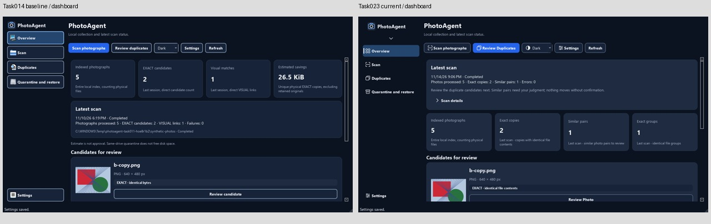
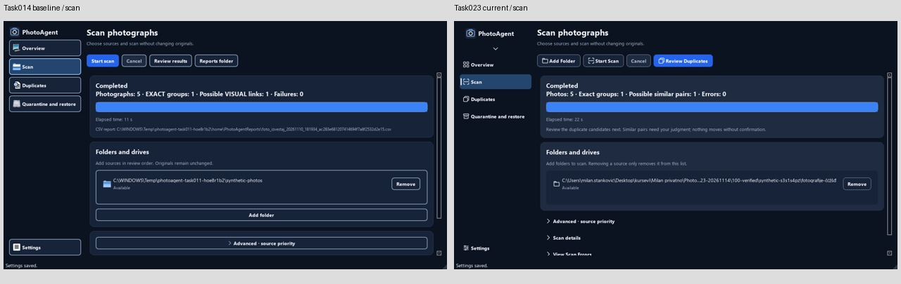
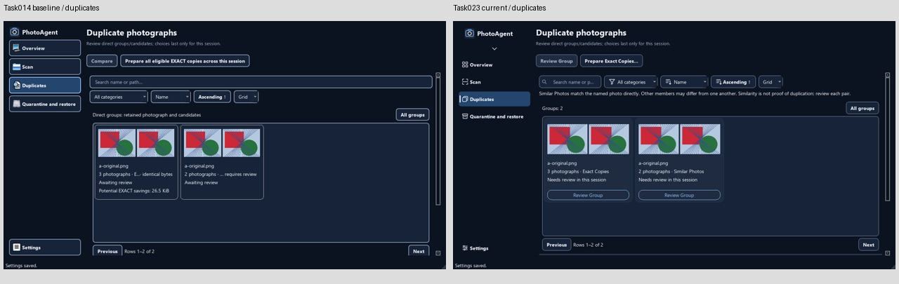
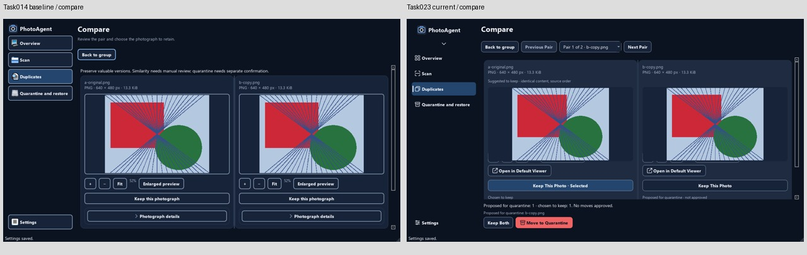
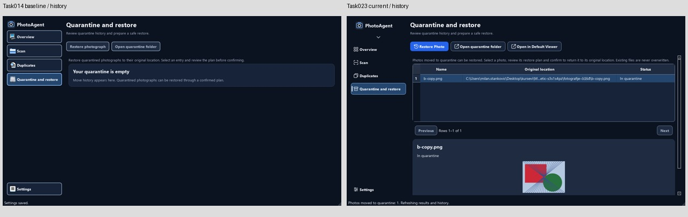
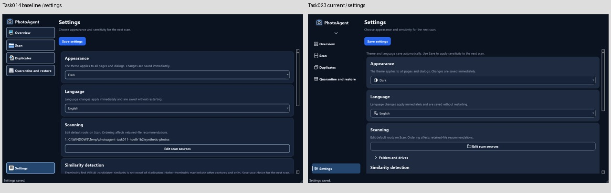

# Task023 — final UI refinement verification

Date: 2026-11-14, Europe/Belgrade. Scope: Task014–Task022 and the nine
Task023 verification requirements. This report separates executable evidence,
visual inspection and native/manual acceptance. Task013 packaging/release gates
remain outside this milestone.

Verification is in progress. Results below must be populated from this run,
not copied from earlier task reports. Full acceptance remains conditional on
the native/manual gates in section I.

## Scope and evidence boundaries

Only generated photographs and isolated application homes, Qt settings, indexes,
reports and operation journals are used. Existing capture directories remain
unchanged. [New evidence](verification/task023-20261114/README.md) records exact
capture manifests, review coverage and any unsuccessful attempts.

Offscreen `QWidget.grab` proves what Qt rendered, not what a physical screen,
screen reader or external viewer displayed. Simulated System color-scheme signals
prove response handling, not OS settings integration. A real OS launch request
also needs an inspected viewer screenshot or a human observation to establish
successful display of that specific photograph.

## A — findings and their verification

Finding IDs refer to [Task014's baseline audit](UI_REFINEMENT_PLAN.md).
The implementation belongs to the preceding tasks; Task023 verifies their current
combined behavior and adds a restart/conflict journey.

| Initial findings | Current implementation and checks |
|---|---|
| G01–G02 | Task015 local line icons and Task016 compact/expanded navigation; design-system and Task016 contrast, focus, accessible checked state, keyboard and geometry tests. |
| D01–D03, S01–S03 | Task017 explicit next actions, session/index counters, source controls and progressive scan diagnostics; Task017 tests and final Dashboard/Scan captures. |
| U01–U04 | Task018 Grid/List groups, count/sample distinction, filters and session-local review labels; Task018 tests, including unimplemented-category semantics. |
| C01–C03 | Task020 photo-first direct-pair review, sticky actions and independent keep/propose labels; Task020 tests and three-member final journey. |
| C04, Q02 | Task021 immutable photo/operation-ID opening, worker revalidation and local-file Qt adapter; all Task021 service/event tests plus separately recorded native probe. |
| C05, Q01, Q03 | Task019 history/restore and Task022 wording; final consent/cancel/restart/conflict/restore journey and existing recovery/safety tests. |
| T01–T02 | Task019 grouped Settings and immediate theme/language versus saved matching preferences; restart, persistence and failed-save tests. |
| A01 | Task016/020/022 keyboard, names, focus, long text and small-window tests; final EN/SR × Dark/Light × sidebar/size matrix. Physical accessibility remains open. |

## B — six experiences and before/after

New screenshots and paired Task014 comparisons are indexed in the evidence folder.
Both sides of each pair use 1280×720, EN/Dark and expanded navigation. The old
and new synthetic sessions are not identical pixel-diff fixtures. Empty states
also cover both languages and both themes. The final populated matrix covers
all six experiences with 1280×720 and 853×480 logical windows, both sidebar modes,
both themes and both languages at DPR 1 and 1.5.

The six paired comparison sheets are review aids, not current-run screenshots of
the old application. History pairs its empty baseline matrix with current active
history, so that pair alone does not prove a table-density improvement. The
[populated Task014 history](verification/task014-20261110/baseline/dark-history-populated.png)
was separately inspected at its original 1650×900: six columns versus the three
current columns. Compare also differs in keeper-choice state; the selection/status
change is intentional and no pixel-equivalence claim is made.








Initial full-size inspection of the final 100% set confirms that Review Duplicates
dominates a completed Dashboard/Scan, the narrow SR filter controls wrap inside the
page, Compare keeps the proposal/approval distinction and bottom actions visible,
Quarantine uses three columns, and Settings shows its actual language/theme selection.
At 853×480, secondary content and the stacked comparison require vertical scrolling;
this is intentional and differs from clipped shell actions.

Candidate cards still use 128×96 thumbnails and two separate review/open actions.
The more compact candidate row sought by D03 is only partially addressed; this
report does not declare that cosmetic goal completely closed. The final contact
sheet and before/after inspection record is in the evidence index.

## C — shared components

Existing shared components remain the design boundary: `ContextToolbar`,
`CollapsibleSection`, `TechnicalDetails`, `PhotoView`, `PhotoLabel`, status/empty
states and the bounded gallery. Task023 adds verification tools and an end-to-end
test rather than a parallel component/theme system.

## D — icons and sidebar

The local icon family and theme colors are shared across pages. The 64/208 logical
pixel sidebar preserves route, selection, queries and consent while collapsing.
Accessible names/tooltips remain available in compact mode. Existing tests exercise
44-pixel navigation targets, Tab order, Space/Enter, checked state and focus without
moving controls. Its state is session-local, not a new persisted preference.

## E — surfaces, borders and tokens

The single `themes.py` token system retains four surfaces, 1-pixel control outlines,
8/12-pixel control/card radii and 4/8/12/16/24/32 spacing. Contrast and rendered
focus/hover/disabled/selected states are exercised by the design-system tests.
Screenshot inspection checks visible hierarchy and consistency; it cannot certify
screen-reader or physical-display accessibility.

## F — external opening

Single click selects; a photo double-click submits one concrete target. Group
headings/gaps still review/select groups. Explicit buttons, gallery shortcuts and
context actions remain separate from keeper choices, plans and approval.
The worker verifies current identity, containment and full SHA-256; quarantine
targets resolve through the authoritative operation ID after restart. Restored,
missing, replaced or stale files are rejected. URLs use literal local paths,
without a shell or conversion. See [PHOTO_OPENING.md](../PHOTO_OPENING.md).

Automated Task021 launches are mocked; they prove events and safety, not native
display. The native Windows probe used the real adapter on its own generated
collection: zero requests for single click, one for double click and one for the
explicit button, with both requests accepted. The owner separately confirmed
seeing `Task023-ac7b554c05-0-čćžšđ.png` and the expected red rectangle, green ellipse
and blue diagonal lines: “Da, vidim tu sliku i naziv”. This establishes a human
observation of this PNG and filename, not each launch or other formats/contexts.

The two initial OS rectangle screenshots showed an occluding window and were
rejected, renamed and excluded from version control. Direct HWND capture returned
a blank surface, also rejected. The probe now captures the title-matched HWND
directly, without substituting another window's screen pixels. Neither failed
capture is represented as viewer display evidence. The owner observation and
accepted requests have separate entries in the native manifest. Linux, JPEG/RAW
display and the complete native context journey remain separate gates.
Read-only inspection identified `Photos.exe` for both title-matched synthetic
windows and recorded the current PNG UserChoice ProgID without changing it.

The automated restart journey recreates the window and service after all its
workers stop and reopens the on-disk journal in the same Qt process. Existing
process/crash recovery tests supply separate process-boundary evidence. Full
native GUI process restart remains part of the manual checklist.

## G — changed files

Task023 adds `tests/test_task023.py`, `tools/capture_task023.py`,
`tools/review_task023.py`, `tools/verify_task023_native.py`, this report and the
new evidence folder. `.gitignore` explicitly permits the final evidence, while
excluding native synthetic home/index/fixture directories. Relevant testing,
changelog, roadmap, architecture, design/accessibility and usage documents link
to the final record. The local ignored `task/Task023.md` records acceptance status.

## H — executed checks

Pending current-run results. Exact commands, timings, failures and skips will be
recorded here and in [TESTING.md](../TESTING.md). Raw logs/JUnit stay under
`build/task023/`; their absence from version control does not substitute for the
recorded results.

### Task023 requirement coverage

| Requirement | Executed evidence or explicit limit |
|---|---|
| 1. Focused then regression tests | Fresh per-module pytest runs; exact aggregate and diagnostic attempts recorded below. No historical pass reused. |
| 2. Six experiences and states | Real-widget capture and scripted controls/keys; whole-frame contact sheets and selected originals inspected. Full human traversal of all pages/actions was not performed; only the owner PNG viewer observation supplies native human evidence. |
| 3. Themes/languages/sidebar/size/DPI | Full populated EN/SR × Dark/Light × both sidebar modes × two sizes at actual Qt DPR 1/1.5. System signal tracking is simulated. Real OS theme/DPI/monitor transitions remain unverified. |
| 4. Visual consistency and baseline | All 36 contact sheets and six same-viewport comparison aids inspected; target/sidebar references and old populated history separately opened. Explicit loading-frame replacements preserve originals. |
| 5. Keyboard and affordances | Existing design-system, Task016/020/022 and broader Qt tests cover focus, keys, names, tooltips, stable geometry, selection, long text and action containment. Native mouse/keyboard and assistive technology checklist remains open. |
| 6. Synthetic safety journey | New three-member end-to-end test and capture journeys cover Keep Both/Cancel/one confirmed move/window-service restart/conflict/restore. Existing RAW, stale/missing file and process recovery tests add separate evidence; valid RAW decode is skipped. |
| 7. System viewer | Real Windows Compare single/double/explicit events and accepted PNG requests, plus owner filename/content confirmation. Mocked all-context/quarantine/missing-file tests are separate. Linux, JPEG/RAW and complete native-context journey remain open. |
| 8. Responsiveness/regressions | Held-extraction navigation/theme/language captures; real heartbeat, stale-preview/open/plan, cancellation and close tests. Capture-driver loading/selection/window-target defects repaired and documented. No production regression fix was needed on the evidence available so far. |
| 9. Documentation/scope | This A–J report, evidence index, testing/usage/design/architecture/roadmap updates. No packaging build, publication or Task013 gate closure. |

## I — remaining limitations and risks

- A native Linux desktop is unavailable. Linux viewer associations, focus, scaling
  and display are unverified.
- Physical monitor changes, keyboard/mouse traversal by a human, native assistive
  technology and a complete OS/theme/language matrix need manual acceptance.
- No valid redistributable RAW fixture is configured. Undecodable RAW and protected
  RAW flags are tested; presentation fixtures and format handoff do not prove decode
  or viewer support. RAW is retained by default.
- `DERIVATIVE` and `SIMILAR_CAPTURE` are not independently produced classifications.
  RAW/JPEG sample labels describe displayed formats, not inferred provenance.
- Keep/review labels are session-local. Visual matches remain direct links, not
  transitive duplicate groups or authority for bulk movement.
- Offline/disconnected drives, stale files, races and interruption use synthetic
  tests. Physical media removal, cross-device transfers and power loss are not
  certified. External applications can change a file after validation and before
  an OS viewer reads it.
- Task013 clean-OS packaging, distribution/license and benchmark gates remain open.

## J — reproducible manual acceptance

Use a newly generated collection and an isolated application home only. Never
point this checklist at a real library. Record OS/build, desktop, Python/Qt,
resolution, physical scaling, actual viewer/association and observed filenames.

For a repeatable **Windows manual session**, run this from the repository root
with the project Python. Run the same block again for a full process restart;
the marker prevents reuse of an unrelated existing directory. It never regenerates
or overwrites an existing collection. Add only the displayed `photos` folder in
the UI. To start an independent session, change the final folder name.

```powershell
@'
import os
from pathlib import Path
os.environ['QT_QPA_PLATFORM'] = 'windows'
from PySide6.QtWidgets import QApplication
from app.ui.qt.window import MainWindow
from tools.capture_task011 import isolated_environment
from tools.capture_task012 import isolated_framework_settings
from tools.capture_ux_audit import generate

workspace = Path.cwd().resolve()
sandbox = (workspace / 'build' / 'task023-manual-session').resolve()
assert sandbox.is_relative_to(workspace)
marker = sandbox / '.synthetic-task023'
if not sandbox.exists():
    sandbox.mkdir(parents=True)
    generate(sandbox / 'photos')
    marker.write_text('Task023 synthetic only', encoding='utf-8')
else:
    assert marker.read_text(encoding='utf-8') == 'Task023 synthetic only'
application = QApplication([])
application.setStyle('Fusion')
with isolated_environment(sandbox), isolated_framework_settings(sandbox):
    window = MainWindow(sandbox / 'home')
    window.resize(853, 480)
    window.show()
    application.exec()
'@ | .venv/Scripts/python.exe -B -
```

This is a manual acceptance recipe, not a claimed completed session. On Linux,
use the appropriate native Qt desktop plugin instead of `windows`, and the local
venv Python; do not use `offscreen`/`minimal` as native evidence. Native Linux
execution of this recipe remains unverified here.

1. Start with empty Dashboard, Scan, Duplicates, Compare, Quarantine and Settings.
   Verify Add Folder/Start Scan guidance and unavailable actions. Open/cancel the
   read-only folder chooser. Add only the synthetic folder and scan.
2. Repeat at 1280×720 and 853×480 logical sizes, compact and expanded sidebar,
   Dark/Light, EN/sr_Latn; change real OS System theme and monitor scaling too.
   Expected: no horizontal page scrolling or clipped main actions; readable
   translations, persistent choices and correctly updated icons/focus.
3. While scanning/previewing, use navigation, theme and language controls. Cancel
   a scan and retry. Inspect completed, empty, incomplete, unreadable and missing
   source states. Expected: responsive controls and honest progress/errors;
   incomplete/cancelled results cannot authorize quarantine.
4. Tab/Shift+Tab through each page, use arrows in lists, Enter for Review, Space
   for Keep and Escape for Cancel. Inspect hover, selected and focus states and
   tooltips. Expected: distinct text labels, full-path disclosure and stable
   geometry; screen reader announces names, selection and dangerous actions.
5. Review a three-member EXACT group, keep one direct pair, then Keep Both.
   Expected: no move and no choice for unseen members. Review a VISUAL pair and
   RAW/derivative/backup warnings; none become eligible for exact bulk by appearance.
6. Prepare quarantine, inspect FROM/TO/retained paths and Cancel. Repeat and approve
   only the synthetic copy. Restart, select the journal-backed history record,
   create a synthetic conflict at its original path and request Restore.
   Expected: conflict refused and both files intact. Preserve that conflicting
   file elsewhere, prepare/confirm restore again and compare every original byte.
7. On Windows and Linux separately, single-click then double-click each concrete
   Dashboard, Grid/List, Compare, enlarged and Quarantine photo. Use explicit
   keyboard/button/context actions too. Expected: single click only selects;
   each open targets exactly the clicked filename once. Quarantine opens its
   current journal path after restart; restored/missing/changed files show clear
   errors. Inspect actual viewer content for PNG/JPEG and each supported RAW
   association. Record an accepted launch separately from successful decoding.
8. Close during scanning/preview and restart. Expected: stopped workers, retained
   operation history and no deferred viewer launch or unapproved move.

Every unavailable mandatory check must remain explicitly open; do not mark full
Task023 or the UI refinement milestone accepted solely from test counts/screenshots.
