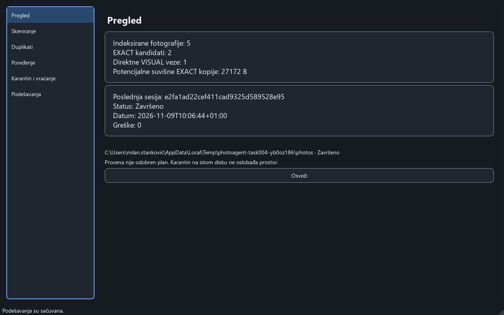
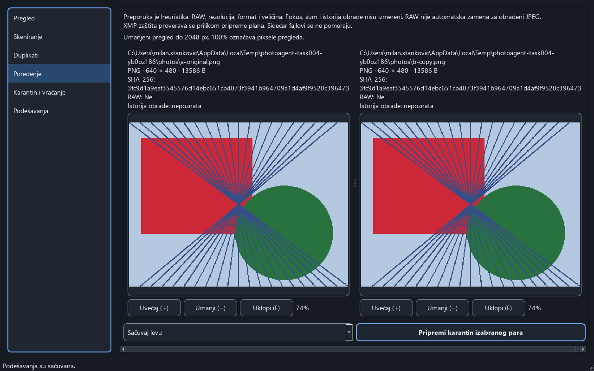

# Task004 — UX audit i plan redizajna

Datum: 2026-11-09. Etapa A Prompta 6.1. Ovo je audit postojećeg Qt interfejsa i ugovor za naredne etape, ne implementacija redizajna. Produkcioni kod, matcher, dekoder, SQLite šema, journal i podešavanja vlasnika nisu menjani.

## Obim, metod i dokazi

Cilj korisnika: odabrati izvore, razumeti rezultate, pregledati konkretne fotografije, eksplicitno odobriti odabrano premeštanje i pouzdano vratiti baš taj fajl posle restarta. Cilj pristupačnosti za redizajn: čitljiv tekst, jasna stanja, smislen fokus i potpuna dostupnost ključnih radnji tastaturom; ovaj audit ne potvrđuje WCAG usklađenost.

Pregledani su aktuelni `screens.py`, `window.py`, `components.py`, `themes.py`, `controller.py`, `workers.py`, `models.py`, `strings.py`, servisni ugovori/upiti, pipeline indeksiranja, model fotografije i relevantni testovi. Git je pre rada pokazivao samo postojeći neprateni `task/`.

Novi dokazi su [24 PNG snimka i manifest](verification/task004/manifest.json), napravljeni kroz [ponovljivu skriptu](../../tools/capture_ux_audit.py). Skripta pokreće stvarni `MainWindow`, Qt event loop, radnike, skeniranje, pripremu planova, operacije i nove servise posle zatvaranja prozora. Radnje pokreće preko window slotova; izbor izvora se postavlja programski umesto kliktanja native folder dijaloga. Podaci nisu ubrizgani u modele ili brojače radi slike.

Okruženje: Windows, Fusion, offscreen Qt, prozor 1280×800 logičkih px; tačne verzije, geometrija, DPR i SHA-256 svakog PNG-a nalaze se u manifestu. Windows offscreen plugin u prvom pokušaju nije našao fontove: tekst se prikazao kao kvadratići. Taj pokušaj je **odbačen** i ostao je ignorisan u `verification/task004-font-rejected/`; nije korišćen za nalaze. Prihvaćeno snimanje učitalo je već instalirane Segoe UI regular/bold fontove samo u procesu alata. Sve 24 prihvaćene slike otvorene su i pregledane pojedinačno; nisu prepravljane.

Sintetički skup ima tri bajt-identične PNG kopije, JPEG izvoz iste generisane slike i drugu generisanu sliku. Kasnije su dodati neispravan `bad.nef` i nepostojeći folder koji simulira nedostupan disk. Home, env putanje za decodere, indeks, journal, izveštaji i fotografije pripadaju privatnom privremenom direktorijumu, uklonjenom tek nakon zaustavljanja radnika. PNG prikazuje stvarne putanje tog sintetičkog direktorijuma; manifest ih zamenjuje sa `<private-temp>`. Nije otvorena niti skenirana korisnička biblioteka.

Postojeći `target_reference.png` i `current_ui.png` otvoreni su odvojeno kao priložene reference. Prvi određuje vizuelni pravac; drugi prikazuje samo istorijsko poređenje. Nijedan nije dokaz novog pokretanja. Referentni pejzaži, nazivi i brojke ne predstavljaju naše rezultate, a RAW/JPEG klasifikacija sa ilustracije nije implementirana funkcija.

## Snimljeni tok i postojeće prednosti

1. Početak: [01 Dashboard](verification/task004/01-dashboard-initial.png), [02 Scan](verification/task004/02-scan-initial.png), [03 Duplicates](verification/task004/03-duplicates-initial.png), [04 Compare](verification/task004/04-compare-initial.png), [05 Quarantine](verification/task004/05-quarantine-initial.png), [06 Settings](verification/task004/06-settings-initial.png). Sve stranice su renderovane iz praznog home-a.
2. Izvori i skeniranje: [07 izvor](verification/task004/07-scan-sources.png), [08 stvarni progress](verification/task004/08-scan-running.png), [09 završetak](verification/task004/09-scan-complete.png). Progress je indeterminate; nema izmišljenog procenta. CSV je zaista napravljen u privatnom home-u.
3. Rezultati: [10 Dashboard](verification/task004/10-dashboard-populated.png), [11 direktne grupe](verification/task004/11-duplicates-populated.png), [12 bez rezultata pretrage](verification/task004/12-duplicates-no-filter-results.png), [13 tri EXACT člana](verification/task004/13-exact-three-members.png). Stvarni rezultat: 5 indeksiranih fajlova, 2 EXACT veze, 1 VISUAL veza, 2 direktne grupe; procena 27.172 B. Tri EXACT člana znače jedan keeper i dva kandidata, ne tri para. EXACT i VISUAL grupa dele keeper, pa zbir članstava nije broj jedinstvenih fotografija.
4. Pregled i odluka: [14 učitane slike](verification/task004/14-compare-exact.png), [15 pripremljeni plan](verification/task004/15-quarantine-confirmation.png). Prvo odbijanje plana sačuvalo je svih pet sadržaja; tek druga eksplicitna potvrda pomerila je jednu sintetičku kopiju.
5. Oporavak: [16 karantin](verification/task004/16-quarantine-populated.png), [17 posle restarta servisa/prozora](verification/task004/17-quarantine-after-restart.png), [18 potvrda konkretnog vraćanja](verification/task004/18-restore-confirmation.png), [19 vraćeno](verification/task004/19-quarantine-restored.png). Originalni bajtovi svih pet fajlova ponovo su provereni. Ovo je restart prozora i servisnih instanci u istom procesu, ne fizički nestanak struje.
6. Greške: [20 neispravan RAW i nedostupan izvor](verification/task004/20-scan-errors-offline.png), [21 incomplete Dashboard](verification/task004/21-dashboard-incomplete.png), [22 stvarni dijalog greške](verification/task004/22-operation-error.png). Bulk dugme je onemogućeno za incomplete sesiju; direktan programski zahtev radniku takođe je odbijen sa `incomplete_scan`. To nije radnja dostupna kroz omogućeno bulk dugme.
7. Preference: [23 popunjena podešavanja](verification/task004/23-settings-populated.png), [24 Light](verification/task004/24-settings-light.png). Tema je upisana kroz servis i proverena u novom prozoru/servisima.

Postojeće prednosti treba zadržati: konkretni EXACT/VISUAL podaci, direktne grupe, paginacija i globalni upiti, stvarne slike iz preview pipeline-a, razumljiva napomena da karantin na istom disku ne oslobađa prostor, indeterminate progress, zaštićena priprema plana i odvojena potvrda, pojedinačni restore i trajno sačuvana tema. Renderovana potvrda je korisna kontrola; bezbednost potvrđuju i servisne provere/testovi, ne sama slika dijaloga.

Pregledani postojeći Dashboard, sa stvarnim sintetičkim brojevima:

Pregledano postojeće poređenje, sa učitanim sintetičkim fotografijama:

## Nalazi i plan po ekranima

Prioriteti ispod određuju redosled UX dorada; nisu tvrdnja da postoji nova dokazana greška koja gubi podatke. Svaki plan je budući rad.

| Površina / dokaz | Nalaz i posledica | Konkretna promena i prihvatanje | Etapa |
|---|---|---|---|
| Okvir, 01–06 | Šest ravnopravnih odredišta izdvaja Compare iz toka. Većina stranica nema naslov; veliki konturni paneli nadjačavaju sadržaj. U ovom offscreen renderu ikone nisu vidljive, iako kod svim stavkama dodeljuje isti resurs. | Pet odredišta: Dashboard, Scan, Duplicates, Quarantine, Settings. Sidebar 190–220 logičkih px, različite lokalne ikone sa tekstom, Settings pri dnu, zajednički PageHeader i status. Routing po stabilnim imenima. Compare unutar Duplicates sa Back. | B/C, Task005/006 |
| Dashboard, 01/10/21 | Četiri brojke su jedan višeredni tekst; UUID poslednje sesije ima veliku težinu. Početnik dobija samo „Osveži”, bez ulaza u prvi scan. Nema sličica. | Četiri StatCard-a sa tačnim nazivima, poslednja sesija sa datumom/statusom, primarni ulaz u Scan, zatim Review Results. Bez sesije EmptyState. UUID u detaljima; incomplete/stale/offline poruke ostaju vidljive. Sličice samo stvarnih kandidata, asinhrono i ograničeno. | D, Task007 |
| Scan, 02/07–09/20 | Prazna lista i prazne greške zauzimaju većinu ekrana. Add/Remove/Gore/Dole i glavne radnje imaju sličnu težinu; nema završnog prelaza na rezultate. Greške prikazuju tehnički tekst. | Jasne source stavke i status, jedna primarna Start Scan radnja; redosled korena objasniti u naprednoj sekciji. Greške/napredne kontrole sklopiti, automatski istaknuti sažetak kad postoje greške. Tokom rada faza/brojevi/vreme/Cancel; na završetku Review Results. CSV ostaje sekundaran. | D, Task007 |
| Duplicates, 03/11–13 | Tekstualne grupe sa odsečenom putanjom uz tabelu nemaju vizuelni ulaz. Dve paginacije su teško razlikljive. Pretraga u Dark ima veoma taman placeholder. Bulk ostaje vizuelno snažan i kad filter nema rezultate (12): njegov opseg je cela sesija. | Bounded model/view Grid i List sa stvarnim sličicama, čitljivim brojem članova i vrstom veze. All/Exact/Similar odgovaraju postojećim podacima. Jasno označiti različite stranice i opseg „cela sesija” za opcioni bulk; prazno stanje ne sme sugerisati da filter ograničava bulk. Ne nuditi neimplementirane klasifikacije. | E, Task008 |
| Compare, 04/14 | Prazan ekran već ima dva ogromna panela, zoom i keeper izbor. Sa podacima duga putanja/SHA i upozorenja dolaze pre fotografija. Nema Back ni Keep Both. | Uvećati značaj stvarnih slika, kratki nazivi/format/dimenzije/veličina, Photo Details sklopljen. Loading/unavailable imaju razlog i kompaktno stanje. Explicit Keep This Photo/Keep Both, bez prećutne saglasnosti. Zadržati zoom/fit, aspect ratio, ograničenje 2048 px i sve relevantne zaštitne poruke. | E, Task008 |
| Potvrda, 15/18/22 | Zamrznuti plan je velik blok: UUID, tehničke akcije, identitet i dva SHA otežavaju brzo razumevanje šta ostaje i šta se pomera. Error dijalog ima korisnu lokalizovanu poruku, ali ne vodi direktno na potreban korak. | Na vrhu broj fajlova i konkretno „ostaje / premešta se / vraća se”, izvor/odredište i mogućnost vraćanja. Tehničke detalje sklopiti; RAW/legacy/XMP/backup/VISUAL upozorenja ostaju vidljiva kad važe. Cancel zadržava početni fokus/default; odobrenje samo zasebnim eksplicitnim postupkom. Greška zadržava stanje za ispravku, bez lažnog uspeha. | E, Task008 |
| Quarantine, 05/16–19 | Prazna tabela ne objašnjava karantin, Restore je aktivan i bez izbora (slot ipak ne pomera ništa). Putanje i „Da/Ne” u koloni sa naslovom radnje slabo objašnjavaju pojedinačni oporavak. | EmptyState, čitljiv naziv/originalna lokacija/status i restore za konkretni operation ID; dugme aktivno samo za podoban izbor. Originalni datum/veličina/sličica samo iz pouzdanih podataka. Otvaranje foldera vezati za izabranu stvarnu karantinsku lokaciju, ne izmišljeni globalni folder. | F, Task009 |
| Settings, 06/23/24 | Jedan formular meša izgled, nedostupan jezik, sirove pragove i zaštitu. Disabled jezik je sličan omogućenom izboru. Čuvanje teme je trenutno, dok pragovi imaju Save. | Appearance, Language, Scanning, Similarity, Safety, Storage, About. Objasniti automatsko čuvanje teme naspram eksplicitnog Save. Balanced=4/6, sačuvati Custom vrednosti; druge preset vrednosti dokumentovati bez tvrdnje o kalibraciji. Trenutno dostupan sr_Latn jasno označiti. ThemeManager i settings format ostaju jedini postojeći sistemi. | F, Task009 |

### Pristupačnost i vizuelni pravac

Na snimcima je osnovni tekst čitljiv, izbor ima pozadinu i tekst, a nazivi dugmadi nose značenje. Rizici: slabo vidljiv placeholder u Dark (03/11), sličnost disabled i enabled kontrola (02/06), oslanjanje na obimne tekstove i odsečene putanje, nedosledni naslovi i snažne konture oko skoro svih kontrola. Kod dodeljuje istoj paleti disabled tekst i menja debljinu ivice na hover/focus; proveriti layout i indikator fokusa pri implementaciji, bez zaključka o ponašanju tastature iz statične slike.

Proširiti postojeće `TOKENS`/`ThemeManager`: navy pozadina, slate kartice, suptilne ivice, jasna tipografska hijerarhija, plava primarna akcija i semantički statusi. Koristiti Task005 paletu kao početak, pa izmeriti kontrast svih stvarnih kombinacija: tekst 4.5:1, veliki tekst i relevantne UI granice/fokus 3:1. Statički kontrast-test postojećih osnovnih tokena ne pokriva placeholder, disabled, sve dijaloge ili tastaturu.

Razmaci 4/8/12/16/24/32, stabilne dimenzije kontrola pri hover/focus, zajednički Card/StatCard/EmptyState/StatusBadge/CollapsibleSection, jedna dominantna radnja. Zadržati Light i System/fallback. Fotografije u proizvodu dolaze isključivo iz stvarne lokalne kolekcije; nema online fontova/ikona, ilustrativnih rezultata ili generisanih pejzaža u aplikaciji. Referenca ima širu navigaciju i drugačije kartice od tekstualnog zahteva: zahtev za širinom i stvarnim metrikama ima prednost.

Task010 proverava Tab/Shift+Tab, Enter/Escape, focus return, accessible name/description i status koji nije prenet samo bojom. Task011 proverava Dark/Light sve glavne ekrane, System, manje ekrane i stvarni DPI. Ovaj audit na 1280×800 ne zatvara te kriterijume.

## Ugovori podataka: izvor, značenje i nedostaci

UI pristupa sledećim podacima preko `Application` i radnika. SQL, čitanje manifest fajlova i dekodiranje ne prelaze u render funkcije. Sve dopune su predlozi za navedenu buduću etapu; u Task004 nije dodat nijedan servisni field.

| Prikaz / metrika | Današnji izvor i stvarno značenje | Nedostajući ugovor / ograničenje / odluka |
|---|---|---|
| Indeksirane fotografije | `Application.dashboard` → `DashboardSummary.indexed`; različiti `(device,inode)` iz `photo_files`, bez `missing/moved` | Globalni indeks, ne broj fotografija poslednjeg skena. Nedostupan disk ne briše zapise. Keš nije odobrenje operacije. |
| Exact kandidati | `DashboardSummary.exact`: broj EXACT redova u `match_results` odabrane/poslednje sesije | Broj direktnih veza; za N kopija tipično N−1, nije broj grupa. |
| Vizuelna podudaranja | `DashboardSummary.visual`: broj VISUAL redova iste sesije | Direktne veze za pregled, bez confidence procenta i bez tranzitivnih tvrdnji. Ne sabirati sa EXACT kao broj jedinstvenih fotografija. |
| Potencijalne suvišne kopije | `DashboardSummary.potential_bytes`: zbir jedinstvenih fizičkih EXACT duplicate kandidata, bez kandidata koji su keeper u sesiji | Procena iz sesije, ne garantovano bezbedni plan: ne sadrži sve RAW/XMP/backup/current-state provere. Karantin na istom disku ne oslobađa prostor. VISUAL ne ulazi u iznos. |
| Poslednji scan | `session_id/status/started/errors/roots/warnings` iz summary-ja; poslednji scan po `started,id`, ne nužno uspešan | Task007: kompatibilna read-only dopuna iz `scan_sessions.metrics` za `photo_count`, `pair_count`, `finished`/trajanje. Bez sesije → odsustvo, ne izmišljeni datum/broj. |
| Greške skena | `DashboardSummary.errors`, `ScanSummary.error_count`, paginirani `Index.errors` kroz worker | Brojevi error zapisa. Ne sabirati sa `ScanProgress.failed` kao različite fajlove; sažetak i detalje prikazati odvojeno. |
| Broj EXACT grupa | `query_groups(session, MatchQuery(kind='EXACT')).total` | Koristiti server-side total cele sesije, ne broj vidljivih redova i ne `exact`. |
| Dostupnost izvora | `Application.sources`, summary roots i `ScanProgress.roots` | Dostupnost sada naspram statusa obilaska u sesiji mora biti označena. Nema procene slobodnog prostora diska. |
| Progress / proteklo vreme | `ScanProgress.phase/discovered/processed/skipped/failed` | Brojevi mogu da se preklapaju; nema pouzdanog procenta svih faza. Lokalni monotonic timer u prikazu za tekući scan; završno vreme iz sesije u read-only dopuni. |
| Grupa / broj članova | `GroupRow(keeper_id,kind,keeper_path,members)`, ključ `(session,kind,keeper_id)` | `members` je cela direktna grupa; tekstualni filter ne pretvara ga u broj samo filtriranih članova. Grupe mogu deliti fotografiju. |
| Gallery thumbnails / metapodaci | `MatchRow.match` nosi Photo za obe strane; `PreviewService` proverava snapshot pre/posle dekodiranja i cache hit-a | `GroupRow` nema Photo/sličicu. Task008: bounded read-only group-card upit za reprezentativne Photo i stabilne ID-jeve; nikada učitavanje svih parova svih grupa u UI. Worker zahtevi/keš ograničeni na vidljive stavke, odbaciti stare rezultate. |
| Ušteda po grupi | Nije deo `GroupRow` | Task008: agregat jedinstvenih fizičkih EXACT duplicate fajlova po grupi, uz isključenje svih keeper-a sesije kao u dashboard formuli. Ne sabirati kartice preko preklapanja; VISUAL → nije primenljivo, ne „0 potvrđeno”. |
| Review status / Keep Both | Nema trajnog review ugovora ili odgovarajućeg settings/journal polja | Za ovaj redizajn samo memorijsko stanje sesije po stabilnim pair ID-jevima; reset pri novom skenu/restartu, jasno označeno. „Needs Review” nije matching klasifikacija. Bez migracije šeme za trajnost. |
| Filter/sort/paginacija | `MatchQuery` i `PageResult`; search naziv/putanja, kind, keeper, sort, offset, limit≤200 | Format je danas sort kolona, ne zaseban format-filter. Ne prikazivati RAW & JPEG, DERIVATIVE ili SIMILAR_CAPTURE kao podržanu detekciju. Grid/List su samo prezentacija istog upita. |
| Kvalitet / detalji | `Photo`: putanja, snapshot, format, ext, dimenzije, RAW, perceptual hashes, decode error; heuristika kvaliteta nije ocena fokusa | Nema kamere, datuma snimanja, bit depth-a, noise/focus merenja, edit istorije ili kalibrisane pouzdanosti. Prikazati „nepoznato”/izostaviti; RAW nije zamena za editovani JPEG. |
| Preview / veliki prikaz | `PreviewService`: orijentisana slika do 2048 px, LRU dekodiranog keša do 64 MiB | Nije originalna puna rezolucija; 100% su pikseli preview-a. Nedostupnost ne briše istoriju ili rezultate; ne zaobilaziti decoder/time/pixel zaštite. |
| Istorija / podobnost | `Application.history` → `HistoryEntry.id/at/source/destination/state/error/restorable`, autoritet je `Journal` | `at` je vreme poslednje tranzicije, ne obavezno prvo premeštanje. `restorable` je trenutna preliminarna podobnost; restore_plan i execute ponovo proveravaju stanje. |
| Datum/veličina/preview karantina | V1 manifest već sadrži `move.expected.size`, source/destination i transitions; `HistoryEntry` ih ne prenosi kao poseban ugovor | Task009: opciona read-only polja sa jasno definisanim vremenom uspešnog quarantine završetka; legacy/nepoznato → nije dostupno. Preview samo sa trenutno proverenog destination-a i odgovarajućeg Photo/snapshot-a kroz servis. Ne koristiti nestali stari source, ne menjati journal format. |
| Restore / Open Folder | Restore koristi izabrani `operation_id`; `restore_plan` + Approval + execute | Nema globalnog karantinskog foldera: lokacija zavisi od root-a i zapisa. Ako se doda Open Folder, uska servisna radnja proverava konkretnu lokaciju bez shell interpolacije. |
| Storage / About / preference | Postoje stvarna lokacija indeksa, tema, pragovi 4/6 i sr_Latn; verzija nije deo Settings ugovora | Ne tvrditi veličinu baze/cache-a bez merenja, ne izmišljati verziju iz planova. About koristi provereni izvor verzije. Sačuvati nepoznate settings ključeve i legacy moves. |

Dozvoljene buduće servisne dopune moraju biti read-only, kompatibilne sa postojećim pozivaocima, parametrizovane/paginirane, obrađene na worker niti i testirane na empty/offline/stale podacima. Ne menjati matcher, klasifikacije, RAW dekodiranje, SQLite šemu ili operation journal radi ovih kartica. Ako potrebni podatak nije dostupan uz te granice, prikazati pošteno odsustvo i zadržati ograničenje u dokumentaciji.

## Ugovor interakcije pre implementacije ekrana

### Grupe sa tri ili više fotografija

EXACT prikazuje keeper i sve direktne kandidate kroz ograničenu paginaciju; broj članova ostaje ukupan. Primer A=B=C: početno su sva tri fajla zadržana dok korisnik ne odabere konkretne kopije za premeštanje. Dozvoljeno je zadržati A i B, a predložiti samo C uz A kao stvarno zadržani par. Za pomeranje A korisnik prvo bira neki drugi zadržani fajl iz iste proverene EXACT grupe. Svaki predlog ima zadržani kandidat koji se ne pomera; ne sme nastati međuzavisnost keeper-a. UI ne proglašava ponovnu validaciju završenom iz keša: `prepare` ponovo proverava fajlove, a `execute` čuva postojeće još jače garancije.

VISUAL prikazuje samo originalne direktne parove i njihove ID-jeve. Za A–B i B–C pregled B–C ne znači A–C; ne rebazirati celu grupu na A niti nuditi bulk vizuelnih kandidata. Promena strane u pojedinačnom paru ostaje pojedinačna proverena odluka. RAW i JPEG mogu oba ostati. Keep Both ne izvršava nikakav filesystem posao, uklanja predlog premeštanja za taj par i opciono pamti lokalno pregledan status do kraja sesije.

### Povratak, izbor i zastareli odgovori

Kontekst Duplicates čine session ID, tekst/kind/keeper filter, sort/smer, offset grupa i parova, Grid/List, group/pair ID i položaj liste. Back vraća taj kontekst i fokus na otvorenu stavku (ili bezbedno prazno stanje ako više ne postoji); ne učitava celu sesiju i ne bira automatski drugi par. Compare nema numerički hardkodiranu top-level rutu.

| Događaj | Obavezno buduće ponašanje |
|---|---|
| Izbor druge grupe/para/keeper-a, Keep Both | Povećati operation epoch, otkazati pripremu i stare preview zahteve, odbaciti postojeći plan/Approval, zatvoriti prikaz zastarele potvrde. Nova odluka je eksplicitna. |
| Filter, sort ili paginacija | Sačuvati novi query kontekst, poništiti pending plan i odluku o premeštanju; ID izbora zadržati samo ako isti zapis zaista postoji u novom rezultatu. Prazan rezultat briše i stare metapodatke i sliku. |
| Back ili promena odredišta dok postoji plan | Sačuvati kontekst pregleda, otkazati pending pripremu/potvrdu i preview koji više nije potreban. Povratak sam ne stvara Approval. |
| Novi scan / promena sesije / close | Invalidate svih izbora, planova i preview generacija. Close ostaje asinhron i čeka završetak radnika; Cancel ne prekida proizvoljno upisanu aktivnu operaciju mimo postojećeg recovery protokola. |
| Izmena izvora tokom scan-a | U redizajnu zaključati uređivanje izvora dok tekući posao ne stane; ne dozvoliti da UI pripiše postojeći scan novim korenima. Zadržati dokumentovani redosled izvora. |
| Kasni preview/query/prepare rezultat | Prihvatiti samo aktuelni request ID i odgovarajući session/selection epoch. Zastareli rezultat ne prikazuje niti izvršava stari plan. |
| Uspeh/neuspeh/otkazivanje operacije | Odbaciti plan i osvežiti stvarne podatke; contextual Restore vezati za konkretni ID, samo ako je podoban. Delimičan neuspeh ne predstavljati kao potpun uspeh; journal i recovery ostaju autoritet. |

Postojeći `Controller.latest`, preview generacije, cancellation events i `MainWindow.operation_epoch/prepare_epoch` su osnova, ne novi paralelni sistem. Audit koda pokazuje da sort/paginacija i Back nemaju kompletan budući lifecycle; ovo su zahtevi za Task006/008, ne tvrdnja da su sada implementirani.

### Potvrda i vraćanje

Prikaz odluke → sveža servisna priprema → prikaz baš tog zamrznutog `Plan` → eksplicitni `Approval` → postojeće izvršavanje → osvežena istorija. Potvrda prikazuje source, retained photo, destination i broj operacija. Cancel je podrazumevan; Enter/dupli klik na sliku ne odobrava plan. Svi postojeći uslovi za RAW unos `RAW`, odvojenu legacy potvrdu, XMP i granice korena/backup kopije ostaju. Samo EXACT može u opcioni bulk uz postojeće kriterijume i zasebnu potvrdu cele sesije.

Restore bira konkretan journal ID, ponovo priprema plan i traži potvrdu. Zauzeto odredište, nestao fajl, promenjen identitet/root ili nepodoban ID daju grešku bez overwrite-a i bez prelaska na drugi zapis. Nijedan ekran ne nudi trajno brisanje ili automatski karantin.

## Redosled isporuke, fajlovi i povratak

| Etapa | Ograničen diff i očekivani fajlovi | Uslov pre sledeće etape |
|---|---|---|
| Task005 / B | Proširiti `themes.py`, `components.py`, `strings.py`, lokalne Qt resurse; regenerisati `resources_rc.py` samo ako je potrebno | Dark/Light komponente, kontrast i vidljiv stabilan fokus; System/persistence regresije |
| Task006 / C | Okvir/rute u `window.py`, ekranima i malim UI modulima; controller samo za nužnu koordinaciju | Pet odredišta, očuvan Back kontekst, epoch/worker/cancel/close provere |
| Task007 / D | Dashboard/Scan, mali read-only summary ugovor u core/services/workers | Tačne metrike za prazan/par/3+/hardlink/overlap/offline skup; stvarni progress i nepotpuna sesija |
| Task008 / E | Gallery/Compare/PlanDialog i bounded preview/read-only group-card dopune | Direktni parovi, više zadržanih EXACT članova, Keep Both, stale izbor/plan, RAW/legacy i quarantine/restart/restore |
| Task009 / F | History/Settings, opcione read-only history dopune | Odabrani restore bez fallback-a/overwrite-a; pošteni datum/veličina, custom/unknown preference sačuvane |
| Task010 / G | Accessible names, fokus, resize/keyboard i stabilni tekstualni ključevi | Tastatura i skaliranje, bez obećavanja runtime jezika |
| Task011 / H | Snimci Dark/Light i ciljna DPI/rezoluciona matrica; relevantne regresije i docs | Stvarni rezultati i otvoreni acceptance gate-ovi, bez deklaracije release-a |

Svaka etapa se pregleda i vraća nezavisno: prezentacija odvojena od kompatibilnih read-only ugovora. Bez migracije šeme/journal-a, novog servera, cloud-a, telemetrije ili uklanjanja Tk fallback-a. Nema commit-a/push-a u ovom zadatku.

Prompt 6.1 obuhvata Task004–011. Novi tekstovi koriste stabilne ključeve i postojeći fallback. Puna EN/SR pokrivenost, runtime promena jezika i English default novih instalacija čekaju **Task012 / Prompt 7 i zaseban nalog**. Završni audit/pakovanje čekaju **Task013 / Prompt 8 i zaseban nalog**. Završetak ovog dokumenta ne zatvara nijednu od tih budućih etapa.

## Provera i ograničenja

Komande, rezultati i preskočene provere zabeleženi su u [TESTING](../TESTING.md): Qt/servisi **21 passed**; operations/recovery **17 passed**, ukupno **38 passed, 0 failed, 0 skipped**. Manifest potvrđuje izvršene scenario asercije; nije zamena za regresione testove. Produkcioni kod nije menjan. `git diff --check`, SHA-256 svih 24 snimka, sve lokalne veze plana i whitespace novih tekstualnih fajlova prošli su proveru. Pregled diff-a nije našao promene u `app/` ili `tests/`.

Ovaj audit ne proverava native naslovnu traku, native folder chooser, čitač ekrana, potpunu tastaturu, fizički monitor/DPI, 1280×720/1366×768/1650×900/1920×1080 matricu, sve stranice u Light/System, Linux, validan licencirani RAW, fizički USB disk ili nestanak struje. Malformed RAW i odsutan folder jesu stvarno korišćeni; oni ne dokazuju sve osobine fizičkog medija. Restart u capture scenariju ne predstavlja crash/power-loss test. Nema tvrdnje da su pakovanje i lokalizacija završeni.

Task004 kriterijumi:

- [x] Svih šest postojećih stranica imaju pregledan novi render i konkretan plan; potvrda, greške i oporavak imaju zasebne dokaze.
- [x] Izvori metrika, značenje, preklapanja i nedostajući ugovori izričito su dokumentovani.
- [x] Definisani su 3+ članova, Back, izbor, poništavanje plana i pojedinačni restore.
- [x] Referenca, safety granice i Prompt 6.1/7/8 ostaju odvojeni.
- [x] Priložene slike, odbačeno snimanje i novo prihvaćeno pokretanje jasno su razdvojeni.
