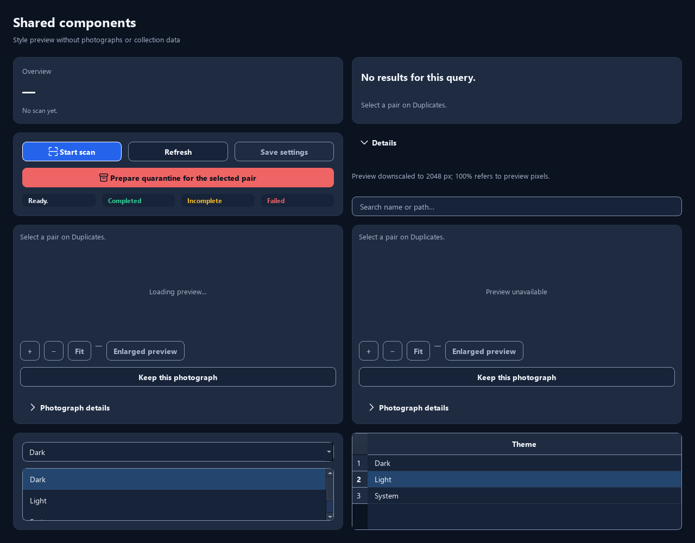
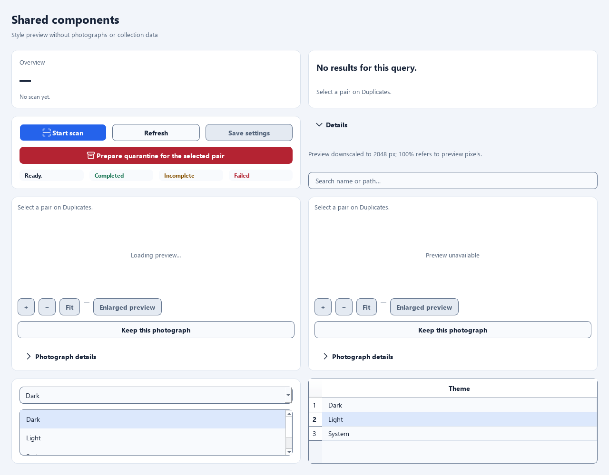

# Task015 verification — 2026-11-10

Scope: shared Qt surfaces, borders and local icons only. Matching, decoding,
SQLite, operation verification and recovery code were not edited. Existing
Task014 audit/plan files and the owner's `.gitignore` additions were preserved;
one ignore exception was added for this evidence directory.

Changed files (Task015 only):

- `app/ui/qt/themes.py`, `components.py`, `navigation.py`, `dashboard_scan.py`,
  `gallery.py`, `screens.py`, `quarantine_settings.py`; new `icons.py`.
- `app/ui/qt/resources/resources.qrc`, `ICONS.md`, `expand.svg`, `collapse.svg`,
  thirteen new SVGs and regenerated `app/ui/qt/resources_rc.py`.
- `tests/test_qt_design_system.py`; new `tools/capture_task015.py`.
- `docs/design/DESIGN_SYSTEM.md`, `ACCESSIBILITY.md`, this evidence directory,
  `docs/TESTING.md`, `docs/CHANGELOG.md`, local `task/Task015.md` status and the
  single Task015 evidence exception in `.gitignore`.

## Executed checks

Environment: Windows 11, existing CPython 3.12 virtual environment, PySide6/Qt
6.12.0, Fusion and `QT_QPA_PLATFORM=offscreen`. Tests use isolated temporary
homes/settings and synthetic fixtures. Capture uses no application services,
photo reads, index, home or journal. Store Python was inaccessible in the sandbox;
the existing virtual environment was run with the approved execution override.
No packages were installed.

```powershell
$env:QT_QPA_PLATFORM='offscreen'
.venv/Scripts/python.exe -B -m pytest tests/test_qt_design_system.py -q
```

Final focused run: **25 passed in 3.80s**, exit 0, no skips. Covers >=4.5:1 text
and >=3:1 relevant control/focus contrast; painted disabled action fills/icons;
every local icon in Normal/Active/Selected/Disabled and On/Off; 2× raster size;
the same icon instances across Light/Dark/System fallback; actual focus painting
on selected navigation and controls; stable content/item geometry; retained
filter/language/theme choices during live EN/SR changes; preview states.

Earlier runs: existing five tests passed; the first expanded run had 22 passes
and two failures because its new fixture created `move_copy` with the helper's
secondary default while asserting danger colors. The test was corrected to pass
the explicit danger variant used by Compare. Subsequent runs passed (24, then
25 tests). The final focused run includes the final painter/type-hint changes.

```powershell
.venv/Scripts/python.exe -B -m pytest tests/test_qt.py tests/test_task008.py tests/test_task009.py tests/test_task010.py tests/test_task011.py tests/test_task012.py -q
.venv/Scripts/python.exe -B -m pytest tests/test_qt.py::test_source_availability_order_removal_and_collapsed_priority -q
```

Final source-list test: **1 passed in 11.02s**, exit 0. This rerun covers moving
the embedded-container property into the constructor before the first polish.
Broad regression: **77 passed, 1 failed, 1 setup error in 10367.74s (2:52:47)**,
exit 1, no skips. Both problems were `Qt worker timeout` in Task008:
`test_exact_multiple_keepers_pagination_and_no_default_move` exceeded its scan
wait (90 s); `test_visual_selection_never_reanchors_a_chain` exceeded the desktop
fixture initialization wait (30 s). This long combined run is not reported as a
clean pass. No production logic or timeouts were changed to hide these results.

The isolated diagnostic rerun, `pytest tests/test_task008.py -q -x`, completed:
**10 passed in 209.02s**, exit 0, no skips. It covers gallery/group selection,
multiple keepers, safe confirmation, contextual restore/conflict and stale replies.
Both timeout-affected cases passed in that rerun using the existing limits.
Together the broad run and Task008 rerun exercised all 79 collected Qt cases
successfully at least once. The long-session timing sensitivity remains a test
limitation; its underlying cause was not established in this UI-only task.

Qt resources were regenerated from the QRC (not hand edited), using the existing
environment's compiler through its Python entry point:

```powershell
.venv/Scripts/python.exe -B -c "import sys; from PySide6.scripts.pyside_tool import rcc; sys.argv = ['pyside6-rcc', 'app/ui/qt/resources/resources.qrc', '-o', 'app/ui/qt/resources_rc.py']; rcc()"
```

## Captures and visual review

```powershell
.venv/Scripts/python.exe -B -m tools.capture_task015 --output docs/design/verification/task015-20261110
```

**17 PNGs captured and opened for visual inspection**. [manifest.json](manifest.json)
records SHA-256, dimensions, DPR, locale, theme preference and active theme.
The final capture was repeated in a fresh `final/` directory after the painter
state guard was added. All 17 hashes were identical; redundant copies were then
removed. The retained files therefore represent the final implementation.

All 17 retained SHA-256 records were rechecked against the files. `git diff
--check` passed; Git emitted only Windows line-ending conversion notices.

| Captures | Reviewed evidence |
|---|---|
| `dark-components`, `light-components` | Raised cards, inputs, selected list/table rows, statuses, disabled actions, frameless disclosure and preview details |
| `dark-icons`, `light-icons` | All 15 roles, primary/secondary/danger/disabled columns, selected and focused navigation |
| `dark-confirmation`, `light-confirmation` | Real PlanDialog widget with invented VISUAL/RAW/XMP plan; warnings visible, Cancel focused, approval disabled; rejected without creating Approval |
| `dark-menu`, `light-menu` | Selected item and disabled restore item with local icons |
| `dark-tooltip`, `light-tooltip` | Shared text, palette and decorative boundary |
| `dark-filters`, `light-filters` | Real Duplicates search/filter/sort controls with icons, unchanged empty state |
| `dark-components-sr`, `light-components-sr` | Existing bound controls update to Serbian Latin; static baseline gallery sample values remain English |
| `system-light`, `system-dark`, `system-fallback` | Same controls survive System callbacks; selector stays System and Duplicates stays checked; fallback is Dark |

The icon grid's role identifiers are developer labels, not new product text.
The gallery list intentionally scrolls internally; it is not a full-page layout
acceptance matrix. No photograph opening, sidebar collapse or new workflow is
implemented by this task.





## Limits

Native Linux, physical Windows/Linux DPI, actual OS theme-change events and
screen readers were not run. System callbacks and 2× icon rendering were tested
programmatically. This is not the Task023 full application acceptance matrix.
No valid RAW asset or physical removable drive was exercised for this UI-only
change. The capture confirmation is presentation evidence, not a move/recovery
test; synthetic operation regressions are reported separately above.
